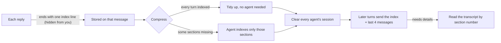

<p align="center"></p>

# AgentDesk

English ｜ [繁體中文](README.zh-TW.md) ｜ [简体中文](README.zh-CN.md)

A desktop chat app that puts several command-line coding agents in one window. The main chat runs on **Claude Code**, and you can add **Codex CLI**, **Cursor Agent CLI**, or any other CLI you configure yourself (for example Antigravity CLI). Claude can delegate work to the other agents, and you see what each of them is doing in real time.

> Windows only for now. AgentDesk ships no AI model of its own: it drives the CLIs already installed and signed in on your machine, so usage and billing go to those accounts.

## Why AgentDesk
- **Several agents, one conversation**: use Claude Code, Codex, Cursor and your own CLIs in turn within the same chat. When you switch agents, AgentDesk passes along what the new one has not seen yet, so there is no copying and pasting.
- **Claude can split the work**: Claude can delegate to Codex or Cursor. A card shows what the other agent is doing as it happens, and its reply ends with a fixed three-line summary.
- **Fewer tokens in long chats**: one click compresses the chat, and from then on each turn sends only an index plus the latest messages. In three real chats, requests averaged 200,000 to 650,000 tokens before compressing and stayed under 65,000 after (see [Measured](#measured-how-much-compression-saves) below). Details are not lost: the agent looks them up in the transcript by section number.
- **The index writes itself as you chat**: each reply ends with a one-line index entry for that turn, so compressing usually just tidies them up, with no agent rereading the chat, no quota used, and done in under a second.
- **No surprise edits**: new chats are read-only. When an agent needs to change files it explains what and why, and you decide whether to switch to work mode.
- **Long work survives restarts**: work mode keeps a progress file with tasks, progress and decisions. A new chat can pick it up, and restarting sessions does not lose progress.
- **Usage you can see**: the right panel shows each agent's session size in this chat and its remaining quota, and suggests compressing or restarting when a session gets large.
- **Your existing accounts**: AgentDesk charges nothing and sends nothing to a third-party server. Chats and transcripts stay on your machine.

## How compression works



## Measured: how much compression saves

<p align="center"></p>

On 2026-11-15 and 16 we measured three real chats. Compression ran on a copy of each chat. "Before" comes from the CLIs' own usage logs while the chat was in real use.

| Chat | Before, resent per request | Compressing | After, resent per request |
|---|---|---|---|
| 146 messages, Claude (Opus 5.5) | average 523,000, max 966,000 (session never restarted) | 157 s, 3 parts, 3 requests, 336,000 tokens in total | 58,000–65,000 |
| 96 messages, mostly Codex | average 205,000, max 389,000 | 89 s, 6 parts, 6 requests, 303,000 in total | 25,000–30,000 |
| 40 messages, Claude (Opus 5.5) | 653,000 | 53 s, 3 requests, 187,000 (old method, see below) | 57,000–61,000 |

- To compress, AgentDesk starts a clean session and hands the agent the text of the sections directly, split into parts when it is long, one request per part. The old method let the agent read the transcript itself: in the 146-message chat Claude read it in 18 pieces, resending everything before each piece, for 2.70 million tokens. Handing over the text cut that to 336,000, 88% less. With Codex the old method used 266,000 but did not read the whole transcript; the new one costs about 10% more and wrote 36 index entries instead of 24. The 40-message row was measured before this change.
- Details afterwards: we asked two or three questions about early discussion in each chat, 11 in all across old and new runs, and every answer was right. The agent searched the transcript by section number, using 30,000 to 230,000 tokens per turn.
- When it pays off: in the 146-message chat, at about 500,000 tokens per request before compressing, the compression pays for itself within one request; if you restart sessions yourself and requests sit around 150,000, it takes about 4.
- Indexing as you chat (the table predates this feature): we asked real Claude and Codex 5 questions each in a new chat. Every turn ended with an index line, and follow-up questions on the same matter reused the previous topic. Compressing turned them into 3–4 entries in under 20 ms, with no agent run.
- Writing the index inside a very large session costs even more: in the same chat, an earlier compression in a 307,000-token session that had seen only part of the chat took 22 requests and 5.5 million tokens. So AgentDesk resumes the agent's session only when that session has seen every section to index and resuming is cheaper.

Caveats:
- Each case was measured once or twice. The numbers change with chat length, project size and model.
- Tokens are not cost. Most requests in a long session are cache reads, which are cheaper, so the money saved is a smaller share than the tokens saved. In the 146-message run tokens dropped 88%, which works out to roughly a quarter less cost at API prices.
- The larger the session, the more compressing saves. Chats with small sessions do not need it.

## Requirements
- Windows 10 / 11
- [Node.js](https://nodejs.org/) 18 or later
- [Claude Code](https://code.claude.com/docs/en/setup) (required); Codex CLI and Cursor Agent CLI are optional. Missing CLIs can be installed and signed in from the Settings page.

## Install and run
AgentDesk does not ship an exe: unsigned exe files are often blocked by antivirus software, so it runs from source.
1. Get the source: download **Source code (zip)** from [Releases](https://github.com/satan0124/AgentDesk/releases/latest) and unzip it, or use git:
   ```bash
   git clone https://github.com/satan0124/AgentDesk.git
   ```
2. Double-click `AgentDesk.bat` in the folder. The first run calls `npm install` to download dependencies (needs internet, a minute or two); after that it opens straight away.

From a terminal, run `npm install` and then `npm start` in the folder.

On first launch, if Claude Code is missing or not signed in, AgentDesk opens Settings so you can click **Install** and **Sign in**.

## Features
- **Chats**: chat history on the left, searchable and grouped by date or by project (working folder), Ctrl+N for a new chat. Right-click a chat to pin, rename, archive or delete it. Each chat has its own working folder and its own unsent draft.
- **Chat mode and work mode**: every chat has its own mode. Switch the open chat with 💬 / 🛠 at the top right of the left sidebar, next to **New chat** (not while a turn is running). New chats start in chat mode, where agents can read but not change anything: Claude runs with `--permission-mode default`, Codex with a read-only sandbox, Cursor with `--mode ask`. Custom agents have no common read-only flag, so they only get an instruction in the prompt. When an agent needs to change a file, it says what it would change and **Switch to work mode and continue** appears under the reply; the same agent carries on once you click it. Cursor is the exception: once its session has run read-only it cannot go back to writing, so AgentDesk starts a new Cursor session and passes the earlier chat along as context. Work mode uses the permissions from Settings. Chats from before this feature existed are in chat mode too, so switch them yourself before an agent can change files.
- **Work and progress files**: when you switch to work mode you can name the work, and AgentDesk creates `docs/進程/<work name>.md` in the working folder. This progress file is the handover file: task list, progress, decisions and verification. AgentDesk tells the agent to list the tasks first, wait for your approval, and update the file on turns that make progress. In a new chat, **Resume work** above the input box lets you pick an existing progress file and carry on; **Work status** in the right panel shows the resume notes and the task list. When one more task is marked done and the largest session in the chat is 50,000 tokens or more, a line above the input box suggests restarting; **Restart sessions** clears every agent's session in this chat, and since the state lives in the progress file, no progress is lost. Chats with a progress file use the Lean cap and send only the last 6 messages as context; the agent reads the background from the file. For a small fix that needs no file, choose **No progress file**.
- **Multiple agents**: only Claude is enabled by default. Add Codex or Cursor the same way as a custom agent: pick it under **Add another CLI agent** at the bottom of Settings and click **+ Add agent**. Switch who you talk to below the input box (Alt+1–9).
- **Model per chat**: click the model name on an agent card in the right panel to pick the model and effort for this chat. Other chats keep the defaults from Settings. The Claude list matches the Claude desktop app: four common models, the rest under **More models**.
- **Delegation**: Claude hands work to other agents through built-in MCP tools (`ask_<agent>`). Each delegation shows up as a card with that agent's tool calls and reply as they happen. AgentDesk asks the delegated agent to end its reply with three lines: what it did, which files it changed, and what is unfinished or worth noting. If the reply is over the cap, the full text is saved as `delegate-<n>.md` in the transcript folder, and Claude gets the shortened reply plus that file's path so it can read the rest when needed.
- **Actions in replies**: when an agent runs two or more tool actions in a row (reading files, running commands), the reply folds them into one line showing the count, how many failed and the latest action; click it to expand. Folding only changes the display: the actions still run and use the same quota.
- **Copy and branch**: hover a message to see its time and a **Copy** button; agent messages also get **Branch from here**, and right-clicking a message offers the same actions. Branching opens a new chat with everything up to that message (same mode, work and folder) and leaves the original chat as it is. Agent sessions are not carried over, so the first turn in the new chat brings the earlier content along as context.
- **Token-saving rule**: every agent has an **Attach the “save tokens” rule** switch in Settings. When it is on, AgentDesk gives that agent the rule at the start of every session: no narration while working, reply only at the end, no repetition, and bad news or unverified items are still stated. AgentDesk asks whether to turn it on when you add a CLI. The rule only applies inside AgentDesk and is not written to the CLI's own rule files.
- **Shared context**: each chat remembers every agent's session. When you talk to an agent directly, whatever it missed from the other agents is passed along automatically. That context counts toward the agent's usage, so it is capped: **Context to include** in Settings offers Lean (about 6,000 characters), Standard (16,000, the default) or Full (40,000). When the cap is reached the newest messages are kept, plus the first request of the chat. Delegation results handed back to Claude are trimmed to the same level. Each reply shows how many characters of earlier chat were sent with it.
- **Compress**: for a long chat, click 🗜 in the top bar. AgentDesk asks the agent selected below the input box to write an index of the chat (this uses one turn of its quota), one line per topic: `#from–#to｜topic｜outcome｜related files`. During the chat, AgentDesk asks the replying agent to end every turn with one extra line indexing that turn. You do not see this line; AgentDesk stores it and merges consecutive turns on the same topic. Compressing uses these lines as they are and asks an agent to index only the sections they miss; if nothing is missing, no agent runs and no quota is used. When sections are missing and that agent's session has seen every section to index and resuming it costs less than rereading, it writes the index in that session; otherwise it starts a clean session and AgentDesk hands it the text of those sections directly, in parts of up to 100,000 characters. AgentDesk then checks the index: related files that never appear in those sections are removed, files changed in those sections are filled in from the action log, and sections the agent skipped get a placeholder entry. For chats without a progress file, the agent also writes a "Current state" line and a "Next steps" line; these are replaced on every compression and sent after the index. A line above the input box says what was written and fixed. Then every agent's session is cleared. From then on, an agent starting a new session gets the index plus the most recent messages instead of the whole chat, and reads the transcript by section number when it needs details. The transcript is a Markdown file AgentDesk writes itself after every turn, one numbered section per message, with no AI usage. A line in the chat marks how far the index reaches; click it to open the index file. Compressing again only indexes the new sections.
- **Attachments**: the **+** menu adds files, photos (Ctrl+U) or a folder. You can also paste screenshots with Ctrl+V or drop files onto the window.
- **Images**: images in replies fit the column width; click one for a full-screen preview (wheel to zoom, drag to pan, ←/→ to switch, Esc to close).
- **Agent activity panel**: shows the current chat only: whether each agent is idle or working, what it is doing and for how long, plus work recently finished in this chat. Each card also shows remaining usage (5-hour and weekly). Claude updates after every reply and Codex is read every 5 minutes; Cursor CLI does not report usage. Each card also shows the size of that agent's session in this chat, which is how many tokens are re-sent at minimum on every later turn (exact for Claude, estimated for Codex and Cursor). **Restart** clears just that agent's session. Above 100,000 the size is flagged and **Compress** appears next to it: it does the same as 🗜 in the top bar, with the agent on that card writing the index.
- **Connect CLIs**: Settings detects whether each CLI is installed, its version and the signed-in account, and can install, sign in or locate it.
- **Custom agents**: **Add another CLI agent** at the bottom of Settings, with templates for Antigravity CLI (`agy`), Claude-compatible stream-json and any plain-text CLI. Configure the command, arguments, how the prompt is passed, output format, model, resume flag, a description for Claude, and more.
- **Language**: English, Traditional Chinese and Simplified Chinese. By default it follows the system: Traditional Chinese systems get Traditional Chinese, Simplified Chinese systems get Simplified Chinese, everything else gets English. You can change it in Settings.

## Permissions
In chat mode agents cannot change files or run commands that change files. In work mode they read and write files and run commands in the chat's working folder. Work-mode defaults: Claude accepts edits automatically, Codex may write in the working folder, Cursor runs commands automatically (`--force`). Adjust these in Settings.

Chat mode cannot stop two things: rules you allowed yourself in your Claude Code settings (`permissions.allow`) still apply, and a custom agent only receives an instruction that nothing enforces. Only use folders you trust.

## Where data lives
`%APPDATA%\AgentDesk\`: `settings.json`, `conversations\*.json`, `attachments\`, `limits.json` (last known usage), `transcripts\<chat id>\` (the transcript `transcript.md` and, after compressing, the index `index.md`). Everything stays on your machine (apart from whatever cloud services the agents themselves call).

Progress files are not stored here. They live under `docs/進程/` in each working folder.

## Project layout
- `src/main.js`: main process, chat storage, local HTTP endpoint used for delegation.
- `src/agents.js`: command lines and stream parsing for each CLI (Claude, Codex, Cursor, custom agents).
- `src/context.js`: what earlier chat is sent to each agent, and the caps.
- `src/mode.js`: chat mode and work mode, and the mode instructions given to agents.
- `src/work.js`: work names, the progress-file template and its parser.
- `src/transcript.js`: writes a chat as a transcript with numbered sections.
- `src/compress.js`: the index used by Compress (the request to the agent, parsing its reply, what later turns carry).
- `src/cli.js`: finds the real executable behind each CLI (avoids Windows `.cmd` shims).
- `src/connect.js`: CLI detection, install and sign-in for the Settings page.
- `src/proc.js`, `src/spawner.js`: spawn child processes on a worker thread so the main process never stalls.
- `src/mcp-bridge.js`: stdio MCP server that Claude uses to delegate.
- `src/shared/i18n.js`: UI translations.
- `src/renderer/`: the UI.
- `tools/make-icon.js`: builds the icon from `build/icon.svg`.

## Using Antigravity
Google replaced Gemini CLI with the Antigravity CLI (`agy`). The Antigravity desktop app does not include it, so install the CLI separately:
1. Settings → pick **Antigravity CLI (agy)** under **Add another CLI agent** → **+ Add agent** → **Install** (runs `irm https://antigravity.google/cli/install.ps1 | iex`).
2. Click **Sign in**: this opens an interactive `agy` session; finish the sign-in wizard there, then close it.
3. Save. AgentDesk sends prompts to `agy` as stream-json on stdin and resumes conversations with `--conversation`.

## Validation
```bash
node tools/validate.js          # static checks, unit tests, fake-agent integration (~3 s, no AI usage)
node tools/validate.js --e2e    # plus an Electron UI run with fake agents
node tools/validate.js --live   # plus real Claude / Codex / Cursor round trips (uses your quota)
```
The fake agents live in `tools/validate/fixtures/`. Results are also written to `.claude/validate-last.md`.

## License
[MIT](LICENSE)
