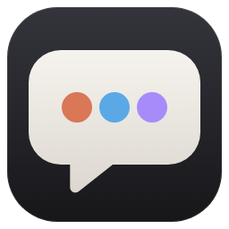
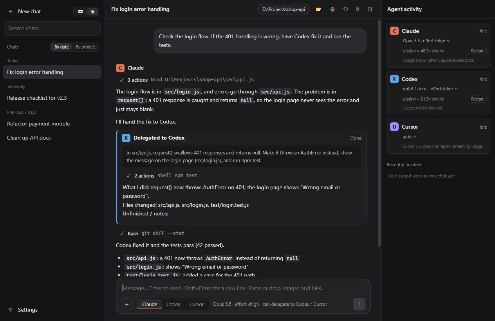
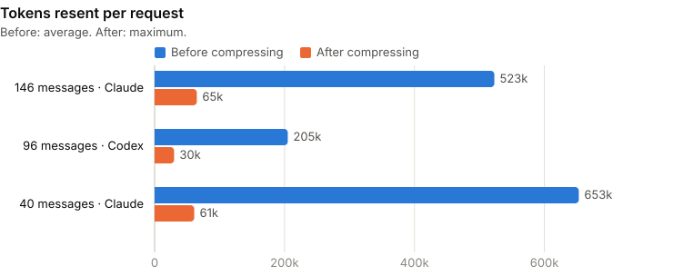

<p align="center"></p>

# AgentDesk

**One desktop workspace for several AI coding agents.**

English ｜ [繁體中文](README.zh-TW.md) ｜ [简体中文](README.zh-CN.md)

AgentDesk puts Claude Code, Codex CLI, Cursor Agent CLI and other CLI agents you configure into one Windows app. Switch agents within the same chat, let Claude hand work to the others, and keep long tasks going across sessions.

> Windows 10 / 11 only. Claude Code is required; the other CLIs are optional. AgentDesk bundles no AI model: it runs the CLIs you have installed and signed in to, and their usage counts against those accounts.

[Quick start](#quick-start) · [Features](#features) · [Benchmarks](guide/benchmarks.md) · [How it works](guide/how-it-works.md)

<p align="center"></p>
<p align="center"><sub>The real app, showing a staged demo chat.</sub></p>

## Why AgentDesk

- **One chat, several agents.** Switch between Claude Code, Codex and Cursor in the same conversation. AgentDesk passes along whatever the new agent missed, so you do not copy and paste.
- **Delegate and still see the work.** Claude can hand a task to Codex or Cursor. A card shows their steps and result as they happen.
- **Long chats stay affordable.** Each reply records a one-line index. Compressing keeps the index and the recent messages, and the agent looks up details in the full transcript. In our tests, requests went from an average of 205,000–653,000 tokens to under 65,000.
- **You decide when files change.** New chats start in chat mode, which tells agents not to edit files; switch to work mode when you want changes. The right panel shows each agent's session size and remaining quota.

## Quick start

You need Windows 10 / 11, [Node.js](https://nodejs.org/) 18 or later, and [Claude Code](https://code.claude.com/docs/en/setup). Claude Code can also be installed and signed in from AgentDesk's Settings. Codex CLI and Cursor Agent CLI are optional.

```bash
git clone https://github.com/satan0124/AgentDesk.git
```

Double-click `AgentDesk.bat` in the folder. The first run installs dependencies with npm (needs internet, a minute or two); after that it opens straight away. From a terminal, run `npm install` and then `npm start`.

On first launch, if Claude Code is missing or not signed in, Settings opens so you can click **Install** and **Sign in**. Pick a working folder for the chat and start.

You can also download **Source code (zip)** from [Releases](https://github.com/satan0124/AgentDesk/releases/latest) and unzip it instead of cloning.

## Example: Claude hands a fix to Codex

This is the chat in the screenshot above.

1. In work mode you ask Claude: "Check the login flow. If the 401 handling is wrong, have Codex fix it and run the tests."
2. Claude reads the code, finds that `request()` swallows 401 responses, and delegates the fix to Codex.
3. The Codex card shows its edits and the test run as they happen. Codex ends with what it did, which files changed, and what is unfinished.
4. Claude checks the diff and reports back. You can keep going with Claude or switch to Codex in the same chat; Codex gets what it missed.

Delegated agents follow the chat's mode, so in chat mode the same read-only limits apply to them.

## Features

**Agent collaboration**

- Only Claude Code is enabled by default. Add others under **Add another CLI agent** at the bottom of Settings, where you can also install and sign in. Supported: Codex CLI and Cursor Agent CLI, plus a template for Antigravity CLI (`agy`); any other CLI can be added by setting its command and output format.
- When you switch agents, the messages the new one missed are sent along, within a cap you choose in Settings.
- Claude delegates through built-in tools, and each delegated agent ends with a three-line summary.

**Context and continuity**

- Compression with an index written as you chat; details stay in a numbered transcript of the whole chat.
- In work mode, a progress file in your project keeps the task list, decisions and verification, so a new chat or a restarted session can carry on.
- Branch a new chat from any agent message.

**Workflow and control**

- Chat mode and work mode per chat (💬 / 🛠 at the top of the sidebar).
- Pick the model and effort per chat from the agent card.
- The right panel shows each agent's status, session size and remaining quota, with **Restart**, plus **Compress** when a session gets large.
- An optional "save tokens" rule per agent: no narration, answer at the end, no repetition.

**Desktop**

- Search chats, group them by date or project, pin, rename and archive; each chat keeps its own draft.
- Attach files and folders, paste screenshots, drop files, and preview images full screen.
- Runs of tool actions fold into one line in replies.
- English, Traditional Chinese and Simplified Chinese UI, following the system language by default.

More detail: [How it works](guide/how-it-works.md).

## Compression benchmark

<p align="center"></p>

- Three real chats, compressed on copies on 2026-11-15 and 16: 146 messages (Claude) 523,000 → 58,000–65,000 tokens per request; 96 messages (Codex) 205,000 → 25,000–30,000; 40 messages (Claude) 653,000 → 57,000–61,000. Before is the average, after is the range.
- Those runs predate indexing as you chat. In later runs with it, real Claude and Codex wrote an index line on every turn (22 of 22), answered 9 of 9 questions about early details, and re-compressing needed an agent only for messages from before the feature.
- Tokens are not cost: most of a long session is cheaper cache reads. Each case was measured once or twice.

Method, all numbers and caveats: [benchmarks](guide/benchmarks.md).

## Safety and privacy

- **Chat mode is not a sandbox.** It tells agents not to change files and uses each CLI's read-only option where one exists. Rules you allowed in Claude Code (`permissions.allow`) still apply, and custom agents only get an instruction.
- **Work mode can change things.** Agents read and write files and run commands in the chat's working folder. Use it only in folders you trust, and check the defaults in Settings.
- **Where data goes.** Chats, transcripts and settings stay in `%APPDATA%\AgentDesk\` on your machine, and AgentDesk runs no server of its own. Each CLI still sends your prompts to its own provider.

## Documentation

- [How it works](guide/how-it-works.md): modes, delegation, compression, progress files, data location, code layout and validation.
- [Benchmarks](guide/benchmarks.md): every compression measurement with method and caveats.

## License

[MIT](LICENSE)
