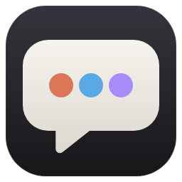

<p align="center"></p>

# AgentDesk

English ｜ [繁體中文](README.zh-TW.md) ｜ [简体中文](README.zh-CN.md)

A desktop chat app that puts several command-line coding agents in one window. The main chat runs on **Claude Code**, and you can add **Codex CLI**, **Cursor Agent CLI**, or any other CLI you configure yourself (for example Gemini CLI). Claude can delegate work to the other agents, and you see what each of them is doing in real time.

> Windows only for now. AgentDesk ships no AI model of its own: it drives the CLIs already installed and signed in on your machine, so usage and billing go to those accounts.

## Requirements
- Windows 10 / 11
- [Node.js](https://nodejs.org/) 18 or later (only when running from source)
- [Claude Code](https://code.claude.com/docs/en/setup) (required); Codex CLI and Cursor Agent CLI are optional. Missing CLIs can be installed and signed in from the Settings page.

## Download
Get the latest build from [Releases](https://github.com/satan0124/AgentDesk/releases/latest):
- `AgentDesk-Setup-<version>.exe`: installer (per-user, adds Start menu and desktop shortcuts)
- `AgentDesk-<version>-portable.exe`: portable, no install needed

The builds are not code-signed yet, so Windows SmartScreen may warn on first launch: click **More info** → **Run anyway**. Node.js is not needed for these builds; you still need the agent CLIs (see below).

## Run from source
```bash
git clone https://github.com/satan0124/AgentDesk.git
cd AgentDesk
npm install
npm start
```
After that you can also double-click `AgentDesk.bat` (it runs `npm install` the first time).

On first launch, if Claude Code is missing or not signed in, AgentDesk opens Settings so you can click **Install** and **Sign in**.

## Features
- **Chats**: chat history on the left, searchable and grouped by date or by project (working folder), Ctrl+N for a new chat. Right-click a chat to pin, rename, archive or delete it. Each chat has its own working folder and its own unsent draft.
- **Multiple agents**: only Claude is enabled by default. Add Codex or Cursor in Settings, then switch who you talk to below the input box (Alt+1–9).
- **Delegation**: Claude hands work to other agents through built-in MCP tools (`ask_<agent>`). Each delegation shows up as a card with that agent's tool calls and reply as they happen.
- **Shared context**: each chat remembers every agent's session. When you talk to an agent directly, whatever it missed from the other agents is passed along automatically.
- **Attachments**: the **+** menu adds files, photos (Ctrl+U) or a folder. You can also paste screenshots with Ctrl+V or drop files onto the window.
- **Images**: images in replies fit the column width; click one for a full-screen preview (wheel to zoom, drag to pan, ←/→ to switch, Esc to close).
- **Agent activity panel**: whether each agent is idle or working, in which chat, what it is doing and for how long, plus recently finished work.
- **Connect CLIs**: Settings detects whether each CLI is installed, its version and the signed-in account, and can install, sign in or locate it.
- **Custom agents**: **+ Add custom agent** at the bottom of Settings, with templates for Antigravity CLI (`agy`, the successor to Gemini CLI), Gemini CLI, Claude-compatible stream-json and any plain-text CLI. Configure the command, arguments, how the prompt is passed, output format, model, resume flag, a description for Claude, and more.
- **Language**: English, Traditional Chinese and Simplified Chinese. By default it follows the system: Traditional Chinese systems get Traditional Chinese, Simplified Chinese systems get Simplified Chinese, everything else gets English. You can change it in Settings.

## Permissions
Agents read and write files and run commands in the chat's working folder. Defaults: Claude accepts edits automatically, Codex may write in the working folder, Cursor runs commands automatically (`--force`). Adjust these in Settings, and only use folders you trust.

## Where data lives
`%APPDATA%\AgentDesk\`: `settings.json`, `conversations\*.json`, `attachments\`. Everything stays on your machine (apart from whatever cloud services the agents themselves call).

## Project layout
- `src/main.js`: main process, chat storage, local HTTP endpoint used for delegation.
- `src/agents.js`: command lines and stream parsing for each CLI (Claude, Codex, Cursor, custom agents).
- `src/cli.js`: finds the real executable behind each CLI (avoids Windows `.cmd` shims).
- `src/connect.js`: CLI detection, install and sign-in for the Settings page.
- `src/proc.js`, `src/spawner.js`: spawn child processes on a worker thread so the main process never stalls.
- `src/mcp-bridge.js`: stdio MCP server that Claude uses to delegate.
- `src/shared/i18n.js`: UI translations.
- `src/renderer/`: the UI.
- `tools/make-icon.js`: builds the icon from `build/icon.svg`.

## Using Gemini / Antigravity
Google replaced Gemini CLI with the Antigravity CLI (`agy`). The Antigravity desktop app does not include it, so install the CLI separately:
1. Settings → **+ Add custom agent** → template **Antigravity CLI (agy)** → **Install** (runs `irm https://antigravity.google/cli/install.ps1 | iex`).
2. Click **Sign in**: this opens an interactive `agy` session; finish the sign-in wizard there, then close it.
3. Save. AgentDesk sends prompts to `agy` as stream-json on stdin and resumes conversations with `--conversation`.

## Validation
```bash
node tools/validate.js          # static checks, unit tests, fake-agent integration (~3 s, no AI usage)
node tools/validate.js --e2e    # plus an Electron UI run with fake agents
node tools/validate.js --live   # plus real Claude / Codex / Cursor round trips (uses your quota)
```
The fake agents live in `tools/validate/fixtures/`. Results are also written to `.claude/validate-last.md`.

## Building the installer
```bash
npm install
npm run dist
```
Output goes to `dist/`. If the build fails with "Cannot create symbolic link" while extracting `winCodeSign`, either enable Windows Developer Mode, or extract that archive yourself into `%LOCALAPPDATA%\electron-builder\Cache\winCodeSign\winCodeSign-2.6.0` while skipping its `darwin` folder.

## License
[MIT](LICENSE)
