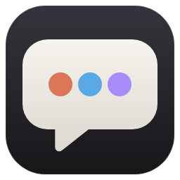

<p align="center"></p>

# AgentDesk

[English](README.md) ｜ [繁體中文](README.zh-TW.md) ｜ 简体中文

一个桌面对话界面，把好几个 CLI 编程 Agent 放在同一个窗口里：主要对话走 **Claude Code**，并可加入 **Codex CLI**、**Cursor Agent CLI**，或任何你自己设置的 CLI（例如 Gemini CLI）。Claude 可以把工作委派给其他 Agent，画面实时显示它们在做什么。

> 目前只支持 Windows。AgentDesk 不含任何 AI 模型，只是调用你电脑上已安装、已登录的 CLI，用量与费用都算在各家账号上。

## 需求
- Windows 10／11
- [Node.js](https://nodejs.org/) 18 以上（只有从源代码运行才需要）
- [Claude Code](https://code.claude.com/docs/en/setup)（必要）；Codex CLI、Cursor Agent CLI 可选。没装也没关系，设置页可以一键安装与登录。

## 下载
到 [Releases](https://github.com/satan0124/AgentDesk/releases/latest) 下载最新版：
- `AgentDesk-Setup-<版本>.exe`：安装版（装在用户自己的文件夹，会创建开始菜单与桌面快捷方式）
- `AgentDesk-<版本>-portable.exe`：免安装版，直接运行

目前还没有代码签名，第一次打开时 Windows SmartScreen 可能会拦截：点“其他信息”→“仍要运行”。用这两个文件不需要 Node.js，但还是要有各 Agent 的 CLI（见下方）。

## 从源代码运行
```bash
git clone https://github.com/satan0124/AgentDesk.git
cd AgentDesk
npm install
npm start
```
之后也可以直接双击 `AgentDesk.bat`（第一次会自动 `npm install`）。

第一次打开时，如果找不到 Claude Code 或还没登录，会直接跳转到设置页，点“安装”“登录”即可。

## 功能
- **对话**：左侧对话记录可搜索，可切换按日期或按项目（工作文件夹）分组，Ctrl+N 新建对话；右键点击对话可置顶、重命名、归档、删除。每个对话有自己的工作文件夹，输入框草稿也各自保存。
- **多个 Agent**：默认只有 Claude。Codex、Cursor 在设置中点“＋ 加入”；输入框下方切换对象（Alt+1～9）。
- **委派**：Claude 通过内置的 MCP 工具（`ask_<agent>`）把工作交给其他 Agent，委派卡片实时显示对方的工具步骤与回复。
- **上下文续接**：每个对话记住各 Agent 的 session；直接跟某个 Agent 讲话时，它没看过的其他 Agent 往来会自动附在前面。
- **附件**：“＋”菜单添加文件／照片（Ctrl+U）或文件夹；也能 Ctrl+V 粘贴截屏、拖放文件进窗口。
- **图片**：回复中的图片缩到栏宽，点击放大预览（滚轮缩放、拖动平移、←/→ 换张、Esc 关闭）。
- **右栏 Agent 工作状况**：每个 Agent 是空闲还是工作中、在哪个对话、正在做什么、经过多久，以及最近完成的工作。
- **连接 CLI**：设置页检测每个 CLI 是否安装、版本、登录账号；可安装、登录、指定路径。
- **自定义 Agent**：设置页最下方“＋ 添加自定义 Agent”，模板有 Antigravity CLI（`agy`，取代 Gemini CLI）、Gemini CLI、Claude 兼容 stream-json、通用 CLI（纯文本）。可设置命令、参数、prompt 传入方式、输出格式、模型、续接 session 标志、给 Claude 的说明等。
- **语言**：界面有繁体中文、简体中文与英文。默认跟随系统：繁体中文系统用繁中、简体中文系统用简中，其他一律英文；可在设置切换。

## 权限提醒
Agent 会在对话的工作文件夹里读写文件、运行命令。默认权限：Claude“自动接受文件修改”、Codex“可写工作文件夹”、Cursor“自动运行命令（--force）”，可在设置调整。请只在你信任的文件夹使用。

## 数据位置
`%APPDATA%\AgentDesk\`：`settings.json`、`conversations\*.json`、`attachments\`。全部存在本机，不会上传到任何地方（Agent 本身调用的云端服务除外）。

## 代码结构
- `src/main.js`：主进程、对话保存、委派用的本机 HTTP。
- `src/agents.js`：各 CLI 的命令组成与流式解析（Claude、Codex、Cursor、自定义 Agent）。
- `src/cli.js`：找 CLI 实际可执行文件（避开 Windows `.cmd` shim）。
- `src/connect.js`：设置页的 CLI 检测、安装、登录。
- `src/proc.js`、`src/spawner.js`：在 worker thread 创建子进程，避免主进程卡住。
- `src/mcp-bridge.js`：给 Claude 用的 stdio MCP server。
- `src/shared/i18n.js`：界面语言对照。
- `src/renderer/`：界面。
- `tools/make-icon.js`：从 `build/icon.svg` 生成图标。

## 使用 Gemini／Antigravity
Google 已用 Antigravity CLI（`agy`）取代 Gemini CLI，Antigravity 桌面版本身不含这个 CLI，要另外装：
1. 设置 →“＋ 添加自定义 Agent”→ 模板选“Antigravity CLI（agy）”→ 点“安装”（运行 `irm https://antigravity.google/cli/install.ps1 | iex`）。
2. 点“登录”：会开一个交互模式的 `agy`，在里面完成登录向导后关掉。
3. 保存。AgentDesk 用 stdin 的 stream-json 传 prompt 给 `agy`，并用 `--conversation` 续接对话。

## 验证
```bash
node tools/validate.js          # 静态检查、单元测试、假 Agent 集成（约 3 秒，不消耗额度）
node tools/validate.js --e2e    # 再加 Electron 界面测试（假 Agent）
node tools/validate.js --live   # 再加真实的 Claude／Codex／Cursor 两轮续接（会消耗额度）
```
假 Agent 放在 `tools/validate/fixtures/`，结果也会写到 `.claude/validate-last.md`。

## 打包安装程序
```bash
npm install
npm run dist
```
输出在 `dist/`。如果解压 `winCodeSign` 时出现“Cannot create symbolic link”，可以打开 Windows 开发者模式，或自己把那个压缩包解到 `%LOCALAPPDATA%\electron-builder\Cache\winCodeSign\winCodeSign-2.6.0`（略过里面的 `darwin` 文件夹）。

## 许可证
[MIT](LICENSE)
