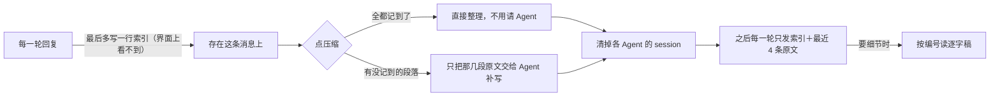

<p align="center"></p>

# AgentDesk

[English](README.md) ｜ [繁體中文](README.zh-TW.md) ｜ 简体中文

一个桌面对话界面，把好几个 CLI 编程 Agent 放在同一个窗口里：主要对话走 **Claude Code**，并可加入 **Codex CLI**、**Cursor Agent CLI**，或任何你自己设置的 CLI（例如 Antigravity CLI）。Claude 可以把工作委派给其他 Agent，画面实时显示它们在做什么。

> 目前只支持 Windows。AgentDesk 不含任何 AI 模型，只是调用你电脑上已安装、已登录的 CLI，用量与费用都算在各家账号上。

## 为什么用 AgentDesk
- **几个 Agent 共用一段对话**：Claude Code、Codex、Cursor 和你自己加的 CLI 在同一个对话里轮流用。换 Agent 时，它没看过的往来 AgentDesk 会自动附上，不用自己复制粘贴。
- **Claude 可以分工**：Claude 能把工作委派给 Codex 或 Cursor，卡片上实时看到对方在做什么，回复会用固定的三行收尾。
- **长对话省 token**：点一下压缩，之后每一轮只发索引加最近几条原文。实测三个真实的对话，压缩前每个请求平均 20 万到 65 万 tokens，压缩后都在 6.5 万以内（见下面的[实测](#实测压缩省多少)）。细节没有丢，Agent 按编号回逐字稿找。
- **索引边聊边记**：Agent 每一轮回复时顺手记一行索引，压缩时直接整理，不用再请 Agent 从头读一遍，通常不消耗额度、一秒内完成。
- **不会乱改文件**：新对话默认只读，Agent 要改文件时先说明，你点了才切到可以改的工作模式。
- **长任务接得上**：工作模式有进度文件记任务、进度与决策。新对话可以接着做，重开 session 也不会丢掉进度。
- **用量看得到**：右栏显示每个 Agent 在这个对话的 session 大小与剩余额度，太大时提醒你压缩或重开。
- **用你现有的账号**：AgentDesk 不另外收费、不经过第三方服务器，对话与逐字稿都存在本机。

## 压缩怎么运作



## 实测：压缩省多少

<p align="center"></p>

2026-11-15～16 拿三个真实的对话实测，压缩都在对话的副本上做。“压缩前”取自同一个对话实际使用时 CLI 自己的用量记录。

| 对话 | 压缩前，每个请求重发 | 压缩本身 | 压缩后，每个请求重发 |
|---|---|---|---|
| 146 条，Claude（Opus 5.5） | 平均 52.3 万、最大 96.6 万（session 一直没重开时） | 157 秒，分 3 批，共 3 个请求、33.6 万 tokens | 5.8 万～6.5 万 |
| 96 条，主要是 Codex | 平均 20.5 万、最大 38.9 万 | 89 秒，分 6 批，共 6 个请求、30.3 万 | 2.5 万～3.0 万 |
| 40 条，Claude（Opus 5.5） | 65.3 万 | 53 秒，3 个请求、18.7 万 | 5.7 万～6.1 万 |

- 这三组是“边聊边记索引”加入之前测的，索引全部由 Agent 在压缩时一次写完；现在多数段落对话时已经记好，压缩本身花得更少（见下面两条）。
- 压缩后问细节：每个对话各问两到三题早期讨论的细节，三个对话、新旧做法加起来共 11 题，全部答对。Agent 会按编号去逐字稿搜索，一轮 3 万到 23 万 tokens。
- 多久省回来：146 条的对话按压缩前每个请求 50 万上下算，压缩本身一个请求就省回来；如果平时会自己重开 session、每个请求 15 万上下，大约 4 个请求省回来。
- 边聊边记索引：真的 Claude、Codex 各开一个新对话问 5 轮，每一轮都写了索引行，连续问同一件事时照抄了上一轮的主题。压缩时两边都直接整理成 3～4 条，没有请 Agent，不到 20 毫秒。
- 长对话接着聊：拿两段已经压缩过的真实长对话（Claude 150 条、Codex 108 条），各接着问 6 轮，其中 9 题问早期的细节，全部答对。12 轮都记了索引；之后每个请求的 session 是 Claude 7.2 万～8.3 万、Codex 2.4 万～5.9 万。再压缩一次时，新问的 6 轮直接整理，只有加入这个功能之前留下的 14～20 条要请 Agent 补写，一个请求、16～31 秒。

需要先说明的：
- 每种情况只测过一两次。数字会随对话长度、项目大小与模型变化。
- token 数不等于费用。长 session 的请求大多是缓存读取，单价比较低，所以省下的钱比例会比 token 小。例如 146 条那次 token 少 88%，按 API 价格粗估费用约少四分之一。
- session 越大，压缩省得越多；session 本来就小的对话不用压。

## 需求
- Windows 10／11
- [Node.js](https://nodejs.org/) 18 以上
- [Claude Code](https://code.claude.com/docs/en/setup)（必要）；Codex CLI、Cursor Agent CLI 可选。没装也没关系，设置页可以一键安装与登录。

## 安装与启动
1. 获取源代码：到 [Releases](https://github.com/satan0124/AgentDesk/releases/latest) 下载“Source code (zip)”并解压，或用 git：
   ```bash
   git clone https://github.com/satan0124/AgentDesk.git
   ```
2. 双击文件夹里的 `AgentDesk.bat`。第一次会先运行 `npm install` 下载依赖（需要联网，约一两分钟），之后双击就直接打开。

想用命令行的话，在文件夹里运行 `npm install`，再运行 `npm start`。

第一次打开时，如果找不到 Claude Code 或还没登录，会直接跳转到设置页，点“安装”“登录”即可。

## 功能
- **对话**：左侧对话记录可搜索，可切换按日期或按项目（工作文件夹）分组，Ctrl+N 新建对话；右键点击对话可置顶、重命名、归档、删除。每个对话有自己的工作文件夹，输入框草稿也各自保存。
- **对话模式与工作模式**：每个对话各自记一种模式，用左侧栏右上角（“新对话”右边）的 💬／🛠 切换当前打开的对话，回合运行中不能换。新对话默认是对话模式，Agent 只能读不能改（自定义 Agent 只在 prompt 里交代）。Agent 需要改文件时会先说明要改什么，消息下方出现“切换到工作模式并继续”，点了才由同一个 Agent 接着做。工作模式按设置页的权限。
- **工作与进度文件**：切换到工作模式时可以取一个工作名，AgentDesk 会在工作文件夹创建 `docs/進程/<工作名>.md`。这份进度文件是交接文件，记任务清单、进度、决策与验证。AgentDesk 会交代 Agent：先列任务、等你确认再动手，有进展的那一轮回写进度文件。新对话可以点输入框上方的“接续工作”，选现成的进度文件接着做；右栏的“工作现状”显示续传指引与任务清单。任务清单多完成一项、而且这个对话最大的 session 到 50,000 tokens 以上时，输入框上方会提示可以重开 session，点“重开 session”就清掉这个对话所有 Agent 的 session；状态都在进度文件里，重开不会丢掉进度。只是改个小地方、不想建文件，选“不建进度文件”。
- **多个 Agent**：默认只有 Claude。Codex、Cursor 和自定义 Agent 一样，在设置最下方的“添加其他 CLI Agent”选好后点“＋ 添加 Agent”；输入框下方切换对象（Alt+1～9）。
- **每个对话各自的模型**：点右栏 Agent 卡片上的模型名称，选这个对话要用的模型和强度，其他对话按设置里的默认值。Claude 直接列出常用的四个，其余在“更多模型”。
- **委派**：Claude 通过内置的 MCP 工具（`ask_<agent>`）把工作交给其他 Agent，委派卡片实时显示对方的工具步骤与回复。AgentDesk 会请被委派的 Agent 在回复最后用三行收尾：做了什么、改了哪些文件、没做完或要注意的。回复太长时，完整内容另存成文件，Claude 需要时自己去读。
- **回复里的操作**：Agent 连续做两个以上的操作（读文件、运行命令等）时，回复里收成一行，显示个数、失败几个与最新的一个操作，点了才展开。折叠只影响界面，操作照样执行，消耗的额度一样。
- **消息的复制与分支**：鼠标移到消息上，下方会显示时间与“复制”；Agent 的消息多一个“从这里分支”，在消息上点右键也有同样的功能。分支会开一个新对话，带着到那一条为止的内容（模式、工作、文件夹照旧），原本的对话不动。
- **省 token 规则**：设置页每个 Agent 都能勾选附上“极度节省 token”规则。勾选后，AgentDesk 在每个 session 开头把规则附给它：工作过程不写旁白、只在收尾回复结果、不重述，坏消息与未验证的事照常讲。添加 CLI 时会询问要不要加。规则只在 AgentDesk 里有效，不会写进各 CLI 自己的规则文件。
- **上下文续接**：每个对话记住各 Agent 的 session；直接跟某个 Agent 讲话时，它没看过的其他 Agent 往来会自动附在前面。附上的内容会计入该 Agent 的用量，所以有上限：设置里的“附带上下文”可选精简（约 6,000 字）、标准（16,000 字，默认）或完整（40,000 字）。超过上限时保留最新的往来和对话开头的需求。每条回复上会标出这一轮附了多少字。
- **压缩**：对话很长时点顶栏的 🗜，运作方式见[流程图](#压缩怎么运作)。平时每一轮 Agent 会在回复最后记一行索引（界面上看不到），格式是 `#起–#迄｜主题｜结论｜相关文件`。压缩时直接整理这些索引，只有没记到的段落才请输入框下方选的 Agent 补写，这时会消耗它一轮额度。没有进度文件的对话另外记“现状”“下一步”两行。压缩后清掉各 Agent 的 session，之后每一轮只发索引加最近几条原文，要细节时 Agent 按编号去读逐字稿。逐字稿是 AgentDesk 每一轮结束后自己写的 Markdown，不消耗额度。消息之间有一条线标出索引涵盖到哪，点击打开索引文件。
- **附件**：“＋”菜单添加文件／照片（Ctrl+U）或文件夹；也能 Ctrl+V 粘贴截屏、拖放文件进窗口。
- **图片**：回复中的图片缩到栏宽，点击放大预览（滚轮缩放、拖动平移、←/→ 换张、Esc 关闭）。
- **右栏 Agent 工作状况**：只看当前这个对话：每个 Agent 是空闲还是工作中、正在做什么、经过多久，以及这个对话最近完成的工作。卡片上也显示剩余额度（5 小时、每周；Cursor 没有提供）。卡片上还有这个 Agent 在这个对话的 session 大小，也就是之后每一轮至少要重发多少 tokens（Claude 是准的，Codex、Cursor 是估的）。点“重开”只清这一个 Agent 的 session。超过 100,000 会提醒，旁边多一个“压缩”按钮：和顶栏的 🗜 是同一件事，由这张卡片的 Agent 写索引。
- **连接 CLI**：设置页检测每个 CLI 是否安装、版本、登录账号；可安装、登录、指定路径。
- **自定义 Agent**：设置页最下方“添加其他 CLI Agent”，模板有 Antigravity CLI（`agy`）、Claude 兼容 stream-json、通用 CLI（纯文本）。可设置命令、参数、prompt 传入方式、输出格式、模型、续接 session 标志、给 Claude 的说明等。
- **语言**：界面有繁体中文、简体中文与英文。默认跟随系统：繁体中文系统用繁中、简体中文系统用简中，其他一律英文；可在设置切换。

## 权限提醒
对话模式下 Agent 不能改文件，也不能运行会改动文件的命令。工作模式下 Agent 会在对话的工作文件夹里读写文件、运行命令，默认权限：Claude“自动接受文件修改”、Codex“可写工作文件夹”、Cursor“自动运行命令（--force）”，可在设置调整。

对话模式有两种情况拦不住：你自己在 Claude Code 设置里允许的规则（`permissions.allow`）照样放行；自定义 Agent 只收到文字说明，它不照做也拦不住。请只在你信任的文件夹使用。

## 数据位置
`%APPDATA%\AgentDesk\`：`settings.json`、`conversations\*.json`、`attachments\`、`limits.json`（最近读到的额度）、`transcripts\<对话 id>\`（逐字稿 `transcript.md` 与压缩后的索引 `index.md`）。全部存在本机，不会上传到任何地方（Agent 本身调用的云端服务除外）。

进度文件不在这里，在各个工作文件夹的 `docs/進程/` 下。

## 代码结构
- `src/main.js`：主进程、对话保存、委派用的本机 HTTP。
- `src/agents.js`：各 CLI 的命令组成与流式解析（Claude、Codex、Cursor、自定义 Agent）。
- `src/context.js`：要附给 Agent 的先前对话与上限。
- `src/mode.js`：对话／工作模式的判定，以及给 Agent 的模式说明。
- `src/work.js`：工作名、进度文件的模板与读取。
- `src/transcript.js`：把对话写成有段落编号的逐字稿。
- `src/compress.js`：压缩用的索引（给 Agent 的话、读回索引、之后每一轮附的内容）。
- `src/cli.js`：找 CLI 实际可执行文件（避开 Windows `.cmd` shim）。
- `src/connect.js`：设置页的 CLI 检测、安装、登录。
- `src/proc.js`、`src/spawner.js`：在 worker thread 创建子进程，避免主进程卡住。
- `src/mcp-bridge.js`：给 Claude 用的 stdio MCP server。
- `src/shared/i18n.js`：界面语言对照。
- `src/renderer/`：界面。
- `tools/make-icon.js`：从 `build/icon.svg` 生成图标。

## 使用 Antigravity
1. 设置 → 在“添加其他 CLI Agent”选“Antigravity CLI（agy）”→“＋ 添加 Agent”→ 点“安装”。
2. 点“登录”：会开一个交互模式的 `agy`，在里面完成登录向导后关掉。
3. 保存。

## 验证
```bash
node tools/validate.js          # 静态检查、单元测试、假 Agent 集成（约 3 秒，不消耗额度）
node tools/validate.js --e2e    # 再加 Electron 界面测试（假 Agent）
node tools/validate.js --live   # 再加真实的 Claude／Codex／Cursor 两轮续接（会消耗额度）
```
假 Agent 放在 `tools/validate/fixtures/`，结果也会写到 `.claude/validate-last.md`。

## 许可证
[MIT](LICENSE)
