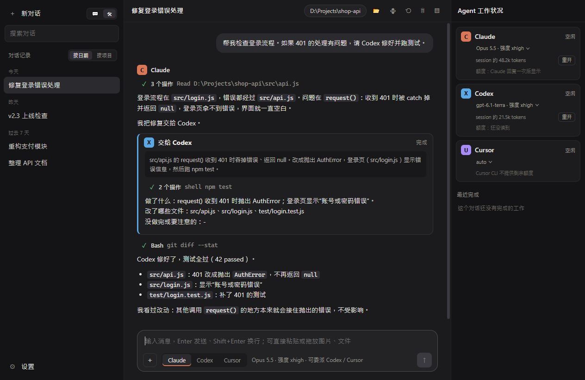
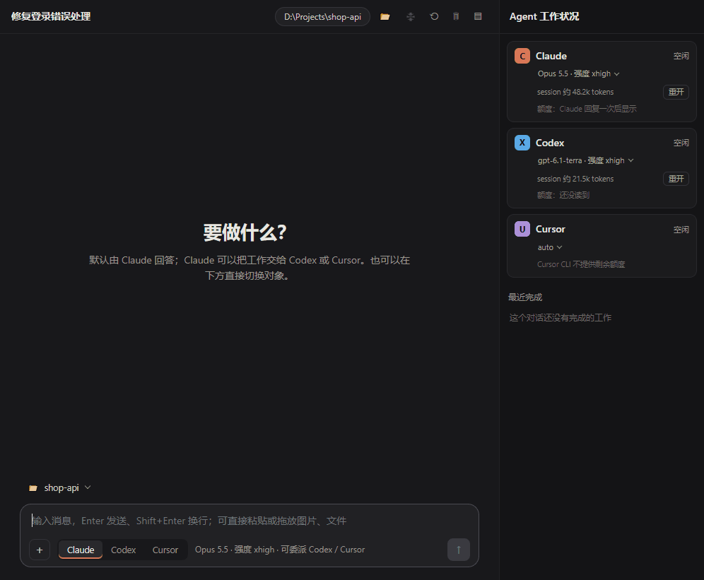
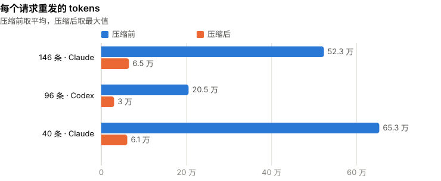

<p align="center"></p>

# AgentDesk

**把几个 AI 编程 Agent 放进同一个桌面工作台。**

[English](README.md) ｜ [繁體中文](README.zh-TW.md) ｜ 简体中文

AgentDesk 把 Claude Code、Codex CLI、Cursor Agent CLI 和你自己设置的 CLI Agent 放进同一个 Windows 程序。同一段对话里可以换 Agent，Claude 可以把工作交给其他 Agent，长时间的工作也能跨 session 接着做。

> 目前只支持 Windows 10／11。Claude Code 必装，其他 CLI 可选。AgentDesk 不含任何 AI 模型，只是调用你电脑上已安装、已登录的 CLI，用量算在各家账号上。

[快速开始](#快速开始) · [功能](#功能) · [实测](guide/benchmarks.zh-CN.md) · [运作方式](guide/how-it-works.zh-CN.md)

<p align="center"></p>
<p align="center"><sub>真实的程序界面，内容是演示用的对话。</sub></p>

## 为什么用 AgentDesk

- **一段对话，几个 Agent。** 同一段对话里可以在 Claude Code、Codex、Cursor 之间切换。新的 Agent 没看过的内容，AgentDesk 会自动附上，不用自己复制粘贴。
- **交出去的工作看得到。** Claude 可以把工作交给 Codex 或 Cursor，卡片上实时显示对方的步骤和结果。
- **长对话也管得住。** 把越来越大的 session 压缩成可以查的索引，完整的对话留在有编号的逐字稿里。实测每个请求重发的 tokens 从 20.5 万～65.3 万降到 6.5 万以内。
- **少花 token。** 每个 Agent 都能勾选“极度节省 token”规则：不写旁白、不重述，坏消息照讲。实测输出 tokens 少四成多，要翻很多文件的调查题总 tokens 少一半左右。
- **跨 session 接着做。** 工作模式用进度文件记任务、决策和验证结果，换新对话或重开 session 都能接着做。
- **讨论和动手分开。** 先在有改文件限制的对话模式讨论，准备好让 Agent 改文件时再切到工作模式。

## 快速开始

需要 Windows 10／11、[Node.js](https://nodejs.org/) 18 以上，以及 [Claude Code](https://code.claude.com/docs/en/setup)。Claude Code 也可以在 AgentDesk 的设置页安装与登录。Codex CLI、Cursor Agent CLI 可选。

```bash
git clone https://github.com/satan0124/AgentDesk.git
```

双击文件夹里的 `AgentDesk.bat`。第一次会先用 npm 安装依赖（需要联网，约一两分钟），之后双击就直接打开。想用命令行的话，运行 `npm install`，再运行 `npm start`。

第一次打开时，如果找不到 Claude Code 或还没登录，会直接跳转到设置页，点“安装”“登录”即可。给对话选好工作文件夹就能开始。

也可以到 [Releases](https://github.com/satan0124/AgentDesk/releases/latest) 下载“Source code (zip)”解压，不用 git。

## 示例：Claude 把修复交给 Codex

就是上面截图里的对话。

<p align="center"></p>
<p align="center"><sub>在真实程序里摆拍的演示，速度加快了。实际委派通常要几分钟。</sub></p>

1. 在工作模式下问 Claude：“帮我检查登录流程。如果 401 的处理有问题，请 Codex 修好并跑测试。”
2. Claude 读过代码，发现 `request()` 把 401 吞掉了，把修复交给 Codex。
3. Codex 的卡片实时显示它的修改和测试，最后写出做了什么、改了哪些文件、还有什么没做完。
4. Claude 看过改动后汇报。你可以继续问 Claude，或在同一段对话切到 Codex，它没看过的内容会自动附上。

被委派的 Agent 跟着对话的模式走，对话模式下一样受只读限制。

## 功能

**多个 Agent 一起做**

- 默认只有 Claude Code，其他 Agent 在设置最下方的“添加其他 CLI Agent”加入，可以直接安装、登录。目前支持 Codex CLI、Cursor Agent CLI，另有 Antigravity CLI（`agy`）的模板；其他 CLI 也能自己设置命令与输出格式加进来。
- 换 Agent 时，它没看过的往来会跟着发过去，上限在设置里选。
- Claude 通过内置工具委派，被委派的 Agent 最后用三行收尾。

**接得上前面的内容**

- 边聊边记索引的压缩；细节留在整段对话的逐字稿里，有段落编号。
- 进度文件放在项目的 `docs/進程/`；新对话点“接续工作”就能打开，任务完成后会提示可以重开 session。
- 可以从任何一条 Agent 消息分支出新对话。

**工作方式与控制**

- 每个对话各自切换对话模式或工作模式（侧栏上方的 💬／🛠）。同一个文件夹已有对话在工作模式运行时，发送前会先问。
- 在 Agent 卡片上给这个对话选模型、强度和权限。Claude 默认改文件、运行命令前都先问你。
- 每条回复显示这一轮用了多少 tokens（CLI 有报告时加上费用），右栏显示这个对话的加总。
- 工作模式下 Claude 可以停下来问你要不要允许命令或改文件。
- 右栏显示每个 Agent 的状态、session 大小与剩余额度，有“重开”，session 偏大时多一个“压缩”按钮。
- 设置页的“环境检查”一次检查 Node.js、各个 CLI 有没有装与登录、工作文件夹能不能写入，有问题的附修法。
- 每个 Agent 可以另外勾选“极度节省 token”规则：不写旁白、只在最后汇报、不重述。

**桌面体验**

- 对话可搜索、按日期或项目分组、置顶、重命名、归档；每个对话的草稿各自保存。
- 可以附加文件或文件夹、粘贴截屏、拖放文件，图片点击后全屏预览。
- 回复里的 Markdown、HTML 文件点击后在右边预览，文件改了会自动更新。
- 回复里连续的操作收成一行。
- 界面有英文、繁体中文、简体中文，默认跟随系统。

更多细节见[运作方式](guide/how-it-works.zh-CN.md)。

## 实测

<p align="center"></p>

- 2026-11-15～16 拿三个真实的对话副本压缩：146 条（Claude）每个请求 52.3 万 → 5.8 万～6.5 万 tokens；96 条（Codex）20.5 万 → 2.5 万～3.0 万；40 条（Claude）65.3 万 → 5.7 万～6.1 万。压缩前有平均值的取平均，压缩后是实际观察到的范围。
- 这三组是“边聊边记索引”加入之前测的。之后加上这个功能再测：真的 Claude、Codex 每一轮都写了索引行（22／22），早期细节 9 题全对，再压缩时只有加入功能之前的段落要请 Agent 补写。
- token 数不等于费用：长 session 大多是比较便宜的缓存读取。每种情况只测过一两次。
- “极度节省 token”规则（2026-11-17，Claude、Codex 各问 4 道题，规则关、开各跑 2 次）：输出 tokens 少 45%／44%，总 tokens 少 38%／18%。答案都正确，“只支持 Windows”“没实测”这类坏消息照讲；省得最多的是要翻很多文件的调查题。

方法、完整数据和注意事项见[实测](guide/benchmarks.zh-CN.md)。

## 安全与隐私

- **对话模式不是沙盒。** 它会交代 Agent 不要改文件，CLI 有只读设置的也会用上。Claude 改文件的工具会停用，但你自己在 Claude Code 允许的 Bash 命令和 MCP 工具（`permissions.allow`）照样能用，自定义 Agent 也只收到文字说明。
- **工作模式会动到东西。** Agent 会在对话的工作文件夹里读写文件、运行命令。请只在你信任的文件夹使用，默认权限可在设置调整。
- **数据去哪里。** 对话、逐字稿和设置都存在本机的 `%APPDATA%\AgentDesk\`，AgentDesk 没有自己的服务器。各 CLI 仍会把 prompt 发到各自的服务商。

## 文档

- [运作方式](guide/how-it-works.zh-CN.md)：模式、委派、压缩、进度文件、数据位置、代码结构与验证。
- [实测](guide/benchmarks.zh-CN.md)：压缩与“极度节省 token”规则的数据，含方法与注意事项。

## 许可

[MIT](LICENSE)
