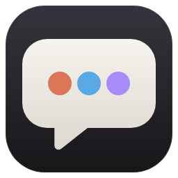

<p align="center"></p>

# AgentDesk

[English](README.md) ｜ 繁體中文 ｜ [简体中文](README.zh-CN.md)

一個桌面對話介面，把好幾個 CLI 程式 Agent 放在同一個視窗裡：主要對話走 **Claude Code**，並可加入 **Codex CLI**、**Cursor Agent CLI**，或任何你自己設定的 CLI（例如 Gemini CLI）。Claude 可以把工作委派給其他 Agent，畫面即時顯示它們在做什麼。

> 目前只支援 Windows。AgentDesk 不含任何 AI 模型，只是呼叫你電腦上已安裝、已登入的 CLI，用量與費用都算在各家帳號上。

## 需求
- Windows 10／11
- [Node.js](https://nodejs.org/) 18 以上（只有從原始碼執行才需要）
- [Claude Code](https://code.claude.com/docs/en/setup)（必要）；Codex CLI、Cursor Agent CLI 可選。沒裝也沒關係，設定頁可以一鍵安裝與登入。

## 下載
到 [Releases](https://github.com/satan0124/AgentDesk/releases/latest) 下載最新版：
- `AgentDesk-Setup-<版本>.exe`：安裝版（裝在使用者自己的資料夾，會建立開始選單與桌面捷徑）
- `AgentDesk-<版本>-portable.exe`：免安裝版，直接執行

目前還沒有程式碼簽章，第一次開啟時 Windows SmartScreen 可能會擋：按「其他資訊」→「仍要執行」。用這兩個檔案不需要 Node.js，但還是要有各 Agent 的 CLI（見下方）。

## 從原始碼執行
```bash
git clone https://github.com/satan0124/AgentDesk.git
cd AgentDesk
npm install
npm start
```
之後也可以直接雙擊 `AgentDesk.bat`（第一次會自動 `npm install`）。

第一次開啟時，如果找不到 Claude Code 或還沒登入，會直接帶到設定頁，按「安裝」「登入」即可。

## 功能
- **對話**：左側對話記錄（依日期分組、可搜尋），Ctrl+N 開新對話；每個對話有自己的工作資料夾，輸入框草稿也各自保存。
- **多個 Agent**：預設只有 Claude。Codex、Cursor 在設定按「＋ 加入」；輸入框下方切換對象（Alt+1～9）。
- **委派**：Claude 透過內建的 MCP 工具（`ask_<agent>`）把工作交給其他 Agent，委派卡片即時顯示對方的工具步驟與回覆。
- **上下文接續**：每個對話記住各 Agent 的 session；直接跟某個 Agent 講話時，它沒看過的其他 Agent 往來會自動附在前面。
- **附件**：「＋」選單新增檔案／相片（Ctrl+U）或資料夾；也能 Ctrl+V 貼上截圖、拖曳檔案進視窗。
- **圖片**：回覆中的圖片縮到欄寬，點擊放大預覽（滾輪縮放、拖曳平移、←/→ 換張、Esc 關閉）。
- **右欄 Agent 工作狀況**：每個 Agent 是閒置還是工作中、在哪個對話、正在做什麼、經過多久，以及最近完成的工作。
- **連結 CLI**：設定頁偵測每個 CLI 是否安裝、版本、登入帳號；可安裝、登入、指定路徑。
- **自訂 Agent**：設定頁最下方「＋ 新增自訂 Agent」，範本有 Antigravity CLI（`agy`，取代 Gemini CLI）、Gemini CLI、Claude 相容 stream-json、一般 CLI（純文字）。可設指令、參數、prompt 傳入方式、輸出格式、模型、接續 session 旗標、給 Claude 的說明等。
- **語言**：介面有繁體中文、簡體中文與英文。預設跟隨系統：繁體中文系統用繁中、簡體中文系統用簡中，其他一律英文；可在設定切換。

## 權限提醒
Agent 會在對話的工作資料夾裡讀寫檔案、執行指令。預設權限：Claude「自動接受改檔」、Codex「可寫工作資料夾」、Cursor「自動執行指令（--force）」，可在設定調整。請只在你信任的資料夾使用。

## 資料位置
`%APPDATA%\AgentDesk\`：`settings.json`、`conversations\*.json`、`attachments\`。全部存在本機，不會上傳到任何地方（Agent 本身呼叫的雲端服務除外）。

## 程式結構
- `src/main.js`：主程序、對話儲存、委派用的本機 HTTP。
- `src/agents.js`：各 CLI 的指令組成與串流解析（Claude、Codex、Cursor、自訂 Agent）。
- `src/cli.js`：找 CLI 實際執行檔（避開 Windows `.cmd` shim）。
- `src/connect.js`：設定頁的 CLI 偵測、安裝、登入。
- `src/proc.js`、`src/spawner.js`：在 worker thread 建立子行程，避免主程序卡住。
- `src/mcp-bridge.js`：給 Claude 用的 stdio MCP server。
- `src/shared/i18n.js`：介面語言對照。
- `src/renderer/`：介面。
- `tools/make-icon.js`：從 `build/icon.svg` 產生 icon。

## 使用 Gemini／Antigravity
Google 已用 Antigravity CLI（`agy`）取代 Gemini CLI，Antigravity 桌面版本身不含這個 CLI，要另外裝：
1. 設定 →「＋ 新增自訂 Agent」→ 範本選「Antigravity CLI（agy）」→ 按「安裝」（執行 `irm https://antigravity.google/cli/install.ps1 | iex`）。
2. 按「登入」：會開一個互動模式的 `agy`，在裡面完成登入精靈後關掉。
3. 儲存。AgentDesk 用 stdin 的 stream-json 傳 prompt 給 `agy`，並用 `--conversation` 接續對話。

## 驗證
```bash
node tools/validate.js          # 靜態檢查、單元測試、假 Agent 整合（約 3 秒，不花額度）
node tools/validate.js --e2e    # 再加 Electron 畫面測試（假 Agent）
node tools/validate.js --live   # 再加真的 Claude／Codex／Cursor 兩輪接續（會用額度）
```
假 Agent 放在 `tools/validate/fixtures/`，結果也會寫到 `.claude/validate-last.md`。

## 打包安裝檔
```bash
npm install
npm run dist
```
輸出在 `dist/`。如果解壓 `winCodeSign` 時出現「Cannot create symbolic link」，可以開啟 Windows 開發人員模式，或自己把那個壓縮檔解到 `%LOCALAPPDATA%\electron-builder\Cache\winCodeSign\winCodeSign-2.6.0`（略過裡面的 `darwin` 資料夾）。

## 授權
[MIT](LICENSE)
