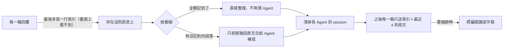

<p align="center"></p>

# AgentDesk

[English](README.md) ｜ 繁體中文 ｜ [简体中文](README.zh-CN.md)

一個桌面對話介面，把好幾個 CLI 程式 Agent 放在同一個視窗裡：主要對話走 **Claude Code**，並可加入 **Codex CLI**、**Cursor Agent CLI**，或任何你自己設定的 CLI（例如 Antigravity CLI）。Claude 可以把工作委派給其他 Agent，畫面即時顯示它們在做什麼。

> 目前只支援 Windows。AgentDesk 不含任何 AI 模型，只是呼叫你電腦上已安裝、已登入的 CLI，用量與費用都算在各家帳號上。

## 為什麼用 AgentDesk
- **幾個 Agent 共用一段對話**：Claude Code、Codex、Cursor 和你自己加的 CLI 在同一個對話裡輪流用。換 Agent 時，它沒看過的往來 AgentDesk 會自動附上，不用自己複製貼上。
- **Claude 可以分工**：Claude 能把工作委派給 Codex 或 Cursor，卡片上即時看到對方在做什麼，回覆會用固定的三行收尾。
- **長對話省 token**：按一下壓縮，之後每一輪只送索引加最近幾則原文。實測三個真實的對話，壓縮前每個請求平均 20 萬到 65 萬 tokens，壓縮後都在 6.5 萬以內（見下面的[實測](#實測壓縮省多少)）。細節沒有丟，Agent 照編號回逐字稿找。
- **索引邊聊邊記**：Agent 每一輪回覆時順手記一行索引，壓縮時直接整理，不用再請 Agent 從頭讀一遍，通常不花額度、一秒內完成。
- **不會亂改檔**：新對話預設唯讀，Agent 要改檔時先說明，你按了才切到可以改的工作模式。
- **長工作接得上**：工作模式有進程檔記任務、進度與決策。新對話可以接著做，重開 session 也不會丟掉進度。
- **用量看得到**：右欄顯示每個 Agent 在這個對話的 session 大小與剩餘額度，太大時提醒你壓縮或重開。
- **用你現有的帳號**：AgentDesk 不另外收費、不經過第三方伺服器，對話與逐字稿都存在本機。

## 壓縮怎麼運作



## 實測：壓縮省多少

<p align="center"></p>

2026-11-15～16 拿三個真實的對話實測，壓縮都在對話的副本上做。「壓縮前」取自同一個對話實際使用時 CLI 自己的用量記錄。

| 對話 | 壓縮前，每個請求重送 | 壓縮本身 | 壓縮後，每個請求重送 |
|---|---|---|---|
| 146 則，Claude（Opus 5.5） | 平均 52.3 萬、最大 96.6 萬（session 一直沒重開時） | 157 秒，分 3 批，共 3 個請求、33.6 萬 tokens | 5.8 萬～6.5 萬 |
| 96 則，主要是 Codex | 平均 20.5 萬、最大 38.9 萬 | 89 秒，分 6 批，共 6 個請求、30.3 萬 | 2.5 萬～3.0 萬 |
| 40 則，Claude（Opus 5.5） | 65.3 萬 | 53 秒，3 個請求、18.7 萬 | 5.7 萬～6.1 萬 |

- 這三組是「邊聊邊記索引」加入之前量的，索引全部由 Agent 在壓縮時一次寫完；現在多數段落對話時已經記好，壓縮本身花得更少（見下面兩條）。
- 壓縮後問細節：每個對話各問兩到三題早期討論的細節，三個對話、新舊做法加起來共 11 題，全部答對。Agent 會照編號去逐字稿搜尋，一輪 3 萬到 23 萬 tokens。
- 多久省回來：146 則的對話照壓縮前每個請求 50 萬上下算，壓縮本身一個請求就省回來；如果平常會自己重開 session、每個請求 15 萬上下，大約 4 個請求省回來。
- 邊聊邊記索引：真的 Claude、Codex 各開一個新對話問 5 輪，每一輪都寫了索引行，連續問同一件事時照抄了上一輪的主題。壓縮時兩邊都直接整理成 3～4 筆，沒有請 Agent，不到 20 毫秒。
- 長對話接著聊：拿兩段已經壓縮過的真實長對話（Claude 150 則、Codex 108 則），各接著問 6 輪，其中 9 題問早期的細節，全部答對。12 輪都記了索引；之後每個請求的 session 是 Claude 7.2 萬～8.3 萬、Codex 2.4 萬～5.9 萬。再壓縮一次時，新問的 6 輪直接整理，只有加入這個功能之前留下的 14～20 則要請 Agent 補寫，一個請求、16～31 秒。

要先講清楚的：
- 每種情況只量過一兩次。數字會隨對話長度、專案大小與模型改變。
- token 數不等於費用。長 session 的請求大多是快取讀取，單價比較低，所以省下的錢比例會比 token 小。例如 146 則那次 token 少 88%，照 API 牌價粗估費用約少四分之一。
- session 越大，壓縮省得越多；session 本來就小的對話不用壓。

## 需求
- Windows 10／11
- [Node.js](https://nodejs.org/) 18 以上
- [Claude Code](https://code.claude.com/docs/en/setup)（必要）；Codex CLI、Cursor Agent CLI 可選。沒裝也沒關係，設定頁可以一鍵安裝與登入。

## 安裝與啟動
1. 取得原始碼：到 [Releases](https://github.com/satan0124/AgentDesk/releases/latest) 下載「Source code (zip)」並解壓縮，或用 git：
   ```bash
   git clone https://github.com/satan0124/AgentDesk.git
   ```
2. 雙擊資料夾裡的 `AgentDesk.bat`。第一次會先執行 `npm install` 下載相依套件（需要網路，約一兩分鐘），之後雙擊就直接開啟。

想用命令列的話，在資料夾裡執行 `npm install`，再執行 `npm start`。

第一次開啟時，如果找不到 Claude Code 或還沒登入，會直接帶到設定頁，按「安裝」「登入」即可。

## 功能
- **對話**：左側對話記錄可搜尋，可切換依日期或依專案（工作資料夾）分組，Ctrl+N 開新對話；對話按右鍵可釘選、重新命名、封存、刪除。每個對話有自己的工作資料夾，輸入框草稿也各自保存。
- **對話模式與工作模式**：每個對話各自記一種模式，用左側欄右上角（「新對話」右邊）的 💬／🛠 切換目前開著的對話，回合執行中不能換。新對話預設是對話模式，Agent 只能讀不能改（自訂 Agent 只在 prompt 裡交代）。Agent 需要改檔時會先說明要改什麼，訊息下方出現「切到工作模式並繼續」，按了才由同一個 Agent 接著做。工作模式照設定頁的權限。
- **工作與進程檔**：切到工作模式時可以取一個工作名，AgentDesk 會在工作資料夾建立 `docs/進程/<工作名>.md`。這份進程檔是交接檔，記任務清單、進度、決策與驗證。AgentDesk 會交代 Agent：先列任務、等你核准再動手，有進展的那一輪回寫進程檔。新對話可以按輸入框上方的「接續工作」，選現成的進程檔接著做；右欄的「工作現況」顯示續傳指引與任務清單。任務清單多完成一項、而且這個對話最大的 session 到 50,000 tokens 以上時，輸入框上方會提示可以重開 session，按「重開 session」就清掉這個對話所有 Agent 的 session；狀態都在進程檔裡，重開不會丟掉進度。只是改個小地方、不想建檔，選「不建進程檔」。
- **多個 Agent**：預設只有 Claude Code，其他 Agent 在設定最下方的「新增其他 CLI Agent」加入，可以直接安裝、登入。目前支援 Codex CLI、Cursor Agent CLI，另有 Antigravity CLI（`agy`）的範本；其他 CLI 也能自己設定指令與輸出格式加進來。輸入框下方切換對象（Alt+1～9）。
- **每個對話各自的模型**：右欄 Agent 卡片上的模型名稱可以點，選這個對話要用的模型與強度，其他對話照設定裡的預設。Claude 直接列出常用的四個，其餘在「更多模型」。
- **委派**：Claude 透過內建的 MCP 工具（`ask_<agent>`）把工作交給其他 Agent，委派卡片即時顯示對方的工具步驟與回覆。AgentDesk 會請被委派的 Agent 在回覆最後用三行收尾：做了什麼、改了哪些檔、沒做完或要注意的。回覆太長時，完整內容另存成檔，Claude 需要時自己去讀。
- **回覆裡的動作**：Agent 連續做兩個以上的動作（讀檔、跑指令等）時，回覆裡收成一行，顯示個數、失敗幾個與最新的一個動作，點了才展開。收合只影響畫面，動作照樣有做，花的額度一樣。
- **訊息的複製與分支**：滑鼠移到訊息上，下方會顯示時間與「複製」；Agent 的訊息多一顆「從這裡分支」，在訊息上按右鍵也有同樣的功能。分支會開一個新對話，帶著到那一則為止的內容（模式、工作、資料夾照舊），原本的對話不動。
- **省 token 規則**：設定頁每個 Agent 都能勾選附上「極度節省 token」規則。勾了之後，AgentDesk 在每個 session 開頭把規則附給它：工作過程不寫旁白、只在收尾回覆結果、不重述，壞消息與未驗證的事照常講。新增 CLI 時會問要不要加。規則只在 AgentDesk 裡有效，不會寫進各 CLI 自己的規則檔。
- **上下文接續**：每個對話記住各 Agent 的 session；直接跟某個 Agent 講話時，它沒看過的其他 Agent 往來會自動附在前面。附上的內容會算進該 Agent 的用量，所以有上限：設定裡的「附帶上下文」可選精簡（約 6,000 字）、標準（16,000 字，預設）或完整（40,000 字）。超過上限時保留最新的往來和對話開頭的需求。每則回覆上會標出這一輪附了多少字。
- **壓縮**：對話很長時按頂列的 🗜，運作方式見[流程圖](#壓縮怎麼運作)。平常每一輪 Agent 會在回覆最後記一行索引（畫面上看不到），格式是 `#起–#迄｜主題｜結論｜相關檔案`。壓縮時直接整理這些索引，只有沒記到的段落才請輸入框下方選的 Agent 補寫，這時會花它一輪額度。沒有進程檔的對話另外記「現況」「下一步」兩行。壓縮後清掉各 Agent 的 session，之後每一輪只送索引加最近幾則原文，要細節時 Agent 照編號去讀逐字稿。逐字稿是 AgentDesk 每一輪結束後自己寫的 Markdown，不花額度。訊息之間有一條線標出索引涵蓋到哪，點了開啟索引檔。
- **附件**：「＋」選單新增檔案／相片（Ctrl+U）或資料夾；也能 Ctrl+V 貼上截圖、拖曳檔案進視窗。
- **圖片**：回覆中的圖片縮到欄寬，點擊放大預覽（滾輪縮放、拖曳平移、←/→ 換張、Esc 關閉）。
- **右欄 Agent 工作狀況**：只看目前這個對話：每個 Agent 是閒置還是工作中、正在做什麼、經過多久，以及這個對話最近完成的工作。卡片上也顯示剩餘額度（5 小時、每週；Cursor 沒有提供）。卡片上還有這個 Agent 在這個對話的 session 大小，也就是之後每一輪至少要重送多少 tokens（Claude 是準的，Codex、Cursor 是估的）。按「重開」只清這一個 Agent 的 session。超過 100,000 會提醒，旁邊多一顆「壓縮」：和頂列的 🗜 是同一件事，由這張卡片的 Agent 寫索引。
- **連接 CLI**：設定頁偵測每個 CLI 是否安裝、版本、登入帳號；可安裝、登入、指定路徑。
- **語言**：介面有繁體中文、簡體中文與英文。預設跟隨系統：繁體中文系統用繁中、簡體中文系統用簡中，其他一律英文；可在設定切換。

## 權限提醒
對話模式下 Agent 不能改檔，也不能執行會改動檔案的指令。工作模式下 Agent 會在對話的工作資料夾裡讀寫檔案、執行指令，預設權限：Claude「自動接受改檔」、Codex「可寫工作資料夾」、Cursor「自動執行指令（--force）」，可在設定調整。

對話模式有兩種情況擋不住：你自己在 Claude Code 設定裡允許的規則（`permissions.allow`）照樣放行；自訂 Agent 只收到文字說明，它不照做也攔不住。請只在你信任的資料夾使用。

## 資料位置
`%APPDATA%\AgentDesk\`：`settings.json`、`conversations\*.json`、`attachments\`、`limits.json`（最近讀到的額度）、`transcripts\<對話 id>\`（逐字稿 `transcript.md` 與壓縮後的索引 `index.md`）。全部存在本機，不會上傳到任何地方（Agent 本身呼叫的雲端服務除外）。

進程檔不在這裡，在各個工作資料夾的 `docs/進程/` 底下。

## 程式結構
- `src/main.js`：主程序、對話儲存、委派用的本機 HTTP。
- `src/agents.js`：各 CLI 的指令組成與串流解析（Claude、Codex、Cursor、自訂 Agent）。
- `src/context.js`：要附給 Agent 的先前對話與上限。
- `src/mode.js`：對話／工作模式的判定，以及給 Agent 的模式說明。
- `src/work.js`：工作名、進程檔的範本與讀取。
- `src/transcript.js`：把對話寫成有段落編號的逐字稿。
- `src/compress.js`：壓縮用的索引（給 Agent 的話、讀回索引、之後每一輪附的內容）。
- `src/cli.js`：找 CLI 實際執行檔（避開 Windows `.cmd` shim）。
- `src/connect.js`：設定頁的 CLI 偵測、安裝、登入。
- `src/proc.js`、`src/spawner.js`：在 worker thread 建立子行程，避免主程序卡住。
- `src/mcp-bridge.js`：給 Claude 用的 stdio MCP server。
- `src/shared/i18n.js`：介面語言對照。
- `src/renderer/`：介面。
- `tools/make-icon.js`：從 `build/icon.svg` 產生 icon。

## 驗證
```bash
node tools/validate.js          # 靜態檢查、單元測試、假 Agent 整合（約 3 秒，不花額度）
node tools/validate.js --e2e    # 再加 Electron 畫面測試（假 Agent）
node tools/validate.js --live   # 再加真的 Claude／Codex／Cursor 兩輪接續（會用額度）
```
假 Agent 放在 `tools/validate/fixtures/`，結果也會寫到 `.claude/validate-last.md`。

## 授權
[MIT](LICENSE)
