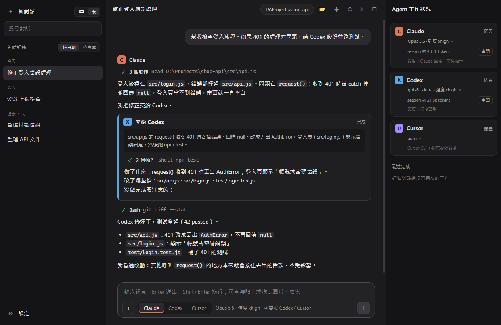
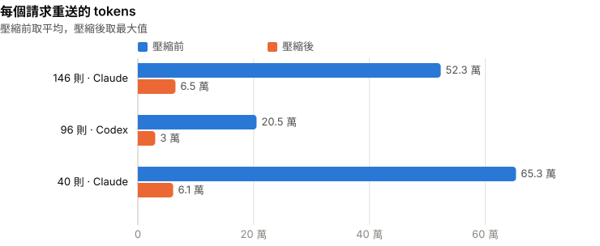

<p align="center"></p>

# AgentDesk

**把幾個 AI 程式 Agent 放進同一個桌面工作台。**

[English](README.md) ｜ 繁體中文 ｜ [简体中文](README.zh-CN.md)

AgentDesk 把 Claude Code、Codex CLI、Cursor Agent CLI 和你自己設定的 CLI Agent 放進同一個 Windows 程式。同一段對話裡可以換 Agent，Claude 可以把工作交給其他 Agent，長時間的工作也能跨 session 接著做。

> 目前只支援 Windows 10／11。Claude Code 必裝，其他 CLI 可選。AgentDesk 不含任何 AI 模型，只是呼叫你電腦上已安裝、已登入的 CLI，用量算在各家帳號上。

[快速開始](#快速開始) · [功能](#功能) · [實測](guide/benchmarks.zh-TW.md) · [運作方式](guide/how-it-works.zh-TW.md)

<p align="center"></p>
<p align="center"><sub>真的程式畫面，內容是示範用的對話。</sub></p>

## 為什麼用 AgentDesk

- **一段對話，幾個 Agent。** 同一段對話裡可以在 Claude Code、Codex、Cursor 之間切換。新的 Agent 沒看過的內容，AgentDesk 會自動附上，不用自己複製貼上。
- **交出去的工作看得到。** Claude 可以把工作交給 Codex 或 Cursor，卡片上即時顯示對方的步驟和結果。
- **長對話也管得住。** 把越來越大的 session 壓縮成可以查的索引，完整的對話留在有編號的逐字稿裡。實測每個請求重送的 tokens 從 20.5 萬～65.3 萬降到 6.5 萬以內。
- **跨 session 接著做。** 工作模式用進程檔記任務、決策和驗證結果，換新對話或重開 session 都能接著做。
- **討論和動手分開。** 先在有改檔限制的對話模式討論，準備好讓 Agent 改檔時再切到工作模式。

## 快速開始

需要 Windows 10／11、[Node.js](https://nodejs.org/) 18 以上，以及 [Claude Code](https://code.claude.com/docs/en/setup)。Claude Code 也可以在 AgentDesk 的設定頁安裝與登入。Codex CLI、Cursor Agent CLI 可選。

```bash
git clone https://github.com/satan0124/AgentDesk.git
```

雙擊資料夾裡的 `AgentDesk.bat`。第一次會先用 npm 安裝相依套件（需要網路，約一兩分鐘），之後雙擊就直接開啟。想用命令列的話，執行 `npm install`，再執行 `npm start`。

第一次開啟時，如果找不到 Claude Code 或還沒登入，會直接帶到設定頁，按「安裝」「登入」即可。替對話選好工作資料夾就能開始。

也可以到 [Releases](https://github.com/satan0124/AgentDesk/releases/latest) 下載「Source code (zip)」解壓縮，不用 git。

## 範例：Claude 把修正交給 Codex

就是上面截圖裡的對話。

1. 在工作模式下問 Claude：「幫我檢查登入流程。如果 401 的處理有問題，請 Codex 修好並跑測試。」
2. Claude 讀過程式，發現 `request()` 把 401 吞掉了，把修正交給 Codex。
3. Codex 的卡片即時顯示它的修改和測試，最後寫出做了什麼、改了哪些檔、還有什麼沒做完。
4. Claude 看過改動後回報。你可以繼續問 Claude，或在同一段對話切到 Codex，它沒看過的內容會自動附上。

被委派的 Agent 跟著對話的模式走，對話模式下一樣受唯讀限制。

## 功能

**多個 Agent 一起做**

- 預設只有 Claude Code，其他 Agent 在設定最下方的「新增其他 CLI Agent」加入，可以直接安裝、登入。目前支援 Codex CLI、Cursor Agent CLI，另有 Antigravity CLI（`agy`）的範本；其他 CLI 也能自己設定指令與輸出格式加進來。
- 換 Agent 時，它沒看過的往來會跟著送過去，上限在設定裡選。
- Claude 透過內建工具委派，被委派的 Agent 最後用三行收尾。

**接得上前面的內容**

- 邊聊邊記索引的壓縮；細節留在整段對話的逐字稿裡，有段落編號。
- 進程檔放在專案的 `docs/進程/`；新對話按「接續工作」就能打開，任務完成後會提示可以重開 session。
- 可以從任何一則 Agent 訊息分支出新對話。

**工作方式與控制**

- 每個對話各自切換對話模式或工作模式（側欄上方的 💬／🛠）。
- 在 Agent 卡片上替這個對話選模型和強度。
- 右欄顯示每個 Agent 的狀態、session 大小與剩餘額度，有「重開」，session 偏大時多一顆「壓縮」。
- 每個 Agent 可以另外勾選「極度節省 token」規則：不寫旁白、只在最後回報、不重述。

**桌面體驗**

- 對話可搜尋、依日期或專案分組、釘選、重新命名、封存；每個對話的草稿各自保存。
- 可以附加檔案或資料夾、貼上截圖、拖曳檔案，圖片點了全螢幕預覽。
- 回覆裡連續的動作收成一行。
- 介面有英文、繁體中文、簡體中文，預設跟隨系統。

更多細節見[運作方式](guide/how-it-works.zh-TW.md)。

## 壓縮實測

<p align="center"></p>

- 2026-11-15～16 拿三個真實的對話副本壓縮：146 則（Claude）每個請求 52.3 萬 → 5.8 萬～6.5 萬 tokens；96 則（Codex）20.5 萬 → 2.5 萬～3.0 萬；40 則（Claude）65.3 萬 → 5.7 萬～6.1 萬。壓縮前有平均值的取平均，壓縮後是實際觀察到的範圍。
- 這三組是「邊聊邊記索引」加入之前量的。之後加上這個功能再測：真的 Claude、Codex 每一輪都寫了索引行（22／22），早期細節 9 題全對，再壓縮時只有加入功能之前的段落要請 Agent 補寫。
- token 數不等於費用：長 session 大多是比較便宜的快取讀取。每種情況只量過一兩次。

方法、完整數據和注意事項見[實測](guide/benchmarks.zh-TW.md)。

## 安全與隱私

- **對話模式不是沙盒。** 它會交代 Agent 不要改檔，CLI 有唯讀設定的也會用上。但你自己在 Claude Code 允許的規則（`permissions.allow`）照樣放行，自訂 Agent 也只收到文字說明。
- **工作模式會動到東西。** Agent 會在對話的工作資料夾裡讀寫檔案、執行指令。請只在你信任的資料夾使用，預設權限可在設定調整。
- **資料去哪裡。** 對話、逐字稿和設定都存在本機的 `%APPDATA%\AgentDesk\`，AgentDesk 沒有自己的伺服器。各 CLI 仍會把 prompt 送到各自的服務商。

## 文件

- [運作方式](guide/how-it-works.zh-TW.md)：模式、委派、壓縮、進程檔、資料位置、程式結構與驗證。
- [實測](guide/benchmarks.zh-TW.md)：所有壓縮數據，含方法與注意事項。

## 授權

[MIT](LICENSE)
