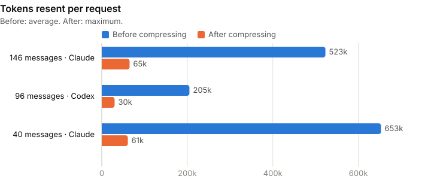

# Benchmarks

English ｜ [繁體中文](benchmarks.zh-TW.md) ｜ [简体中文](benchmarks.zh-CN.md)

Compression was measured on 2026-11-15 and 16 with real chats; how it works is described in [how-it-works.md](how-it-works.md#compression). The "save tokens" rule was measured on 2026-11-17, see [the last section](#save-tokens-rule).

## Method

- Every run used a copy of the chat in a temporary data folder, so the original chat was not touched.
- "Before" comes from the CLIs' own usage logs (Claude `~/.claude/projects`, Codex `~/.codex/sessions`) while the chat was in real use.
- "Tokens re-sent per request" is the size of one request: input, cache writes and cache reads together.
- Each case was run once or twice. Numbers change with chat length, project size and model.

## Three chats, compressed in one go

| Chat | Before, re-sent per request | Compressing | After, re-sent per request |
|---|---|---|---|
| 146 messages, Claude (Opus 5.5) | average 523,000, max 966,000 (session never restarted) | 157 s, 3 parts, 3 requests, 336,000 tokens in total | 58,000–65,000 |
| 96 messages, mostly Codex | average 205,000, max 389,000 | 89 s, 6 parts, 6 requests, 303,000 in total | 25,000–30,000 |
| 40 messages, Claude (Opus 5.5) | 653,000 | 53 s, 3 requests, 187,000 (older method) | 57,000–61,000 |

These runs predate indexing as you chat, so the agent wrote the whole index at compression time.

- **Handing over the text.** An earlier method let the agent read the transcript itself. In the 146-message chat Claude read it in 18 pieces, re-sending everything before each piece, for 2.70 million tokens. Putting the section text in the prompt cut that to 336,000 (88% fewer). With Codex the older method used 266,000 but did not read the whole transcript; the current one costs about 10% more and wrote 36 index entries instead of 24. The 40-message row used the older method.
- **Details afterwards.** We asked two or three questions about early discussion in each chat, 11 in all, and every answer was right. The agent searched the transcript by section number, using 30,000 to 230,000 tokens per turn.
- **When it pays off.** At about 500,000 tokens per request before compressing, the 146-message compression paid for itself within one request. If you restart sessions yourself and requests sit around 150,000, it takes about 4.
- **Very large sessions.** Writing the index inside a 307,000-token session that had seen only part of the chat took 22 requests and 5.5 million tokens. AgentDesk now resumes a session for indexing only when it has seen every section and resuming is cheaper.

## Indexing as you chat

New chats, 5 questions each, real agents:

| Agent | Turns with an index line | Reused the previous topic | Compressing |
|---|---|---|---|
| Codex | 5 / 5 | turns 2 and 4 | 3 entries, 19 ms, no agent run |
| Claude | 5 / 5 | turn 2 | 4 entries, 14 ms, no agent run |

In Claude's 4th turn the working folder's own Stop hook pulled it into an unrelated task; that was the test setup, not the feature.

## Continuing long chats

Two real chats that had already been compressed, copied and continued with 6 questions each:

| | Claude, 150 messages | Codex, 108 messages |
|---|---|---|
| Turns with an index line | 6 / 6 | 6 / 6 |
| Questions about early details | 5 / 5 right | 4 / 4 right |
| Session per request afterwards | 72,000–83,000 | 24,000–59,000 |
| Compressing again | agent indexed the 14 older messages: 1 request, 31 s | agent indexed the 20 older messages: 1 request, 16 s |

The new turns were tidied up directly; only messages from before indexing as you chat needed an agent.

## Caveats

- Tokens are not cost. Most requests in a long session are cache reads, which are cheaper, so the money saved is a smaller share than the tokens saved. In the 146-message run tokens dropped 88%, roughly a quarter less cost at API prices.
- The larger the session, the more compressing saves. Chats with small sessions do not need it.
- The extra tokens for writing the index line each turn have not been measured on their own.
- Cursor and custom agents have not been measured.

## "Save tokens" rule

In Settings you can turn on the "save tokens" rule for each agent (**Attach the “save tokens” rule**). AgentDesk then gives the agent a short rule (about 470 characters in English): no narration, report only at the end, no restating, and still report bad news and anything unverified.

### Method

- 4 questions on a clean copy of the AgentDesk source. Each question ran twice with the rule off and twice with it on, each time in a new session: 16 runs for Claude and 16 for Codex.
  1. Explain what `resumeForIndex` does (chat mode).
  2. Which files and functions run between pressing Stop and seeing "Stopped" (chat mode, needs a dozen or so files).
  3. Add a `slugOf` function to `src/work.js` and try it with `node -e` (work mode).
  4. Can AgentDesk run on Linux or macOS, and where is Windows hard-coded (chat mode; the answer includes "not supported" and "not tested").
- Prompts were built the way AgentDesk builds them, with the same mode note and index-line request; only the rule differed. For Claude the rule goes in the system prompt, for Codex at the start of the prompt.
- Models as normally configured: Claude Opus 5.5 and Codex gpt-6.1-terra, both at xhigh effort.
- Claude ran in safe mode so it did not read the user's global `CLAUDE.md`. The test machine's `CLAUDE.md` already contains the same rule, so the rule-off runs would have read it too.

### Results

Average per question, rule off → on:

| | Claude | Codex |
|---|---|---|
| Output tokens (including thinking) | 5,811 → 3,193 (−45%) | 1,736 → 973 (−44%) |
| Reply characters | 2,422 → 1,386 (−43%) | 1,630 → 775 (−52%) |
| Tool calls | 13 → 9 | 8 → 6 |
| Total tokens (input, cache, output) | 400k → 249k (−38%) | 142k → 117k (−18%) |
| Time | 63 → 39 s | 51 → 35 s |
| Cost (API prices reported by the CLI) | $0.44 → $0.29 (−34%) | not reported by the CLI |

Total tokens per question:

| Question | Claude | Codex |
|---|---|---|
| 1. Explain a function | 165k → 115k (−30%) | 62k → 57k (−8%) |
| 2. Trace Stop | 513k → 333k (−35%) | 206k → 199k (−3%) |
| 3. Small code change | 180k → 176k (−2%) | 95k → 105k (+10%) |
| 4. Cross-platform | 742k → 374k (−50%) | 206k → 107k (−48%) |

- The biggest savings come from investigation questions that read many files. With the rule, agents stop after reading fewer files, so they make fewer tool calls, and the session that every call resends is sent fewer times. That is why total tokens on question 4 dropped about as much as output.
- On questions answered in one or two steps, most of the total is the fixed system prompt and the files read, so the rule only saves on the reply itself. Codex used 10% more total tokens on question 3 with the rule on, because one run ran two extra commands.
- Claude's thinking tokens also dropped 63% (2,222 → 825).
- The rule's own tokens are included above: Claude carries it on every request (mostly cache reads); Codex only on the first turn of a session.

### Reply quality

All 16 rule-on replies were checked by hand:

- Every answer was correct. The 8 versions of `slugOf` from question 3 gave the same, correct output for the same inputs.
- Bad news was still reported. All 4 rule-on answers to question 4 said "Windows only" and "not tested on Linux or macOS".
- What got dropped was side detail. Claude no longer listed edge cases such as `a - b` becoming `a---b` on question 3. One Codex answer to question 4 left out the UI's local-path handling, which the other 3 Codex answers mentioned.
- Narration did not disappear completely. With the rule on, Claude sometimes still wrote a line of progress between tool calls (both runs of question 2), and Codex still opened with one "I'll check…" line.

### Caveats

- Each question ran only twice per setting. Cost swings a lot with cache writes: Claude's question 3 cost more with the rule on because one run wrote 40k tokens of cache.
- Claude was measured in safe mode. If your global `CLAUDE.md` already has a similar rule, turning this option on in AgentDesk will not save more.
- Claude's cost is the API price reported by the CLI; subscription plans spend usage limits instead.
- Cursor and custom agents have not been measured.
