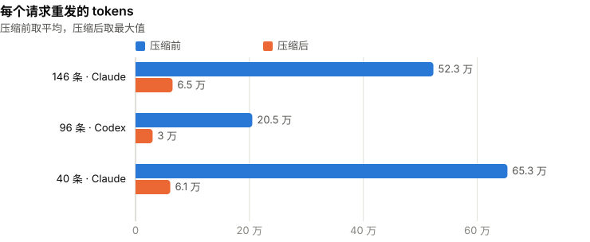

# 实测

[English](benchmarks.md) ｜ [繁體中文](benchmarks.zh-TW.md) ｜ 简体中文

压缩：2026-11-15～16 拿真实的对话实测，压缩怎么运作见 [how-it-works.zh-CN.md](how-it-works.zh-CN.md#压缩)。“极度节省 token”规则：2026-11-17 实测，见[最后一节](#极度节省-token-规则)。

## 方法

- 每次都在临时文件夹的对话副本上做，原本的对话不动。
- “压缩前”取自同一个对话实际使用时 CLI 自己的用量记录（Claude 的 `~/.claude/projects`、Codex 的 `~/.codex/sessions`）。
- “每个请求重发”是一个请求的大小：输入、缓存写入和缓存读取加起来。
- 每种情况只测过一两次。数字会随对话长度、项目大小与模型变化。

## 三个对话一次压缩

| 对话 | 压缩前，每个请求重发 | 压缩本身 | 压缩后，每个请求重发 |
|---|---|---|---|
| 146 条，Claude（Opus 5.5） | 平均 52.3 万、最大 96.6 万（session 一直没重开时） | 157 秒，分 3 批，共 3 个请求、33.6 万 tokens | 5.8 万～6.5 万 |
| 96 条，主要是 Codex | 平均 20.5 万、最大 38.9 万 | 89 秒，分 6 批，共 6 个请求、30.3 万 | 2.5 万～3.0 万 |
| 40 条，Claude（Opus 5.5） | 65.3 万 | 53 秒，3 个请求、18.7 万（旧做法） | 5.7 万～6.1 万 |

这三组是“边聊边记索引”加入之前测的，索引全部由 Agent 在压缩时一次写完。

- **直接交原文**：旧做法让 Agent 自己读逐字稿。146 条的对话 Claude 分 18 次读，每读一段就把前面的内容重发一遍，共 270 万 tokens；改成把段落原文放进 prompt 后是 33.6 万，少 88%。Codex 旧做法 26.6 万，但它没有读完整份逐字稿；现在的做法多花约一成，索引从 24 条变 36 条。40 条那组用的是旧做法。
- **压缩后问细节**：每个对话各问两到三题早期讨论的细节，共 11 题，全部答对。Agent 按编号去逐字稿搜索，一轮 3 万到 23 万 tokens。
- **多久省回来**：146 条那组按压缩前每个请求 50 万上下算，压缩本身一个请求就省回来；如果平时会自己重开 session、每个请求 15 万上下，大约 4 个请求省回来。
- **很大的 session**：在 30.7 万、只看过一部分内容的 session 里写索引，跑了 22 个请求、550 万 tokens。现在只有 session 看过全部要写的段落、而且接续更便宜时，才在原来的 session 里写。

## 边聊边记索引

真的 Agent 各开一个新对话问 5 题：

| Agent | 有写索引行 | 照抄上一轮主题 | 压缩 |
|---|---|---|---|
| Codex | 5／5 | 第 2、4 轮 | 3 条，19 毫秒，没有请 Agent |
| Claude | 5／5 | 第 2 轮 | 4 条，14 毫秒，没有请 Agent |

Claude 第 4 轮被工作文件夹自己的 Stop hook 带去做别的事，这是测试环境造成的，跟这个功能无关。

2026-11-17 另外用 Cursor（模型 auto）和 Antigravity（模型由 CLI 决定，强度 high）在对话模式各问 5 道题，“极度节省 token”规则开着。第 3 题只说“好”，看简短回应会不会按要求不写：

| Agent | 有写索引行 | “好”那轮不写 | 照抄上一轮主题 |
|---|---|---|---|
| Cursor | 4／4 | 有 | 没测到 |
| Antigravity | 4／4 | 有 | 第 2、5 轮 |

- Cursor 把 `[[agentdesk:index]]` 单独写一行，字段写在下一行，旧的解析一行都取不到，之后几轮也就没带上一轮主题。AgentDesk 现在收得下这种写法，两行都会去掉。Cursor 会不会照抄主题，要再跑一次才知道。
- Antigravity 4 行里有 3 行的结论写“未定”，连已经回答的问题也是；主题和相关文件都有写。

**索引行花多少**：2026-11-17 用 Claude（Opus 5.5）和 Codex（gpt-6.1-terra），强度都是 xhigh，在同一个 session 连问同样的 5 道题，每轮都附索引要求或完全不附，各跑两次。Claude 用 safe mode，“极度节省 token”规则没开。整段对话的平均：

| | Claude | Codex |
|---|---|---|
| 输出 tokens | 15,995 → 16,143（+1%） | 2,992 → 2,453（−18%） |
| 总 tokens | 97.7 万 → 84.4 万（−14%） | 36.3 万 → 26.4 万（−27%） |
| 5 轮后的 session | 6.84 万 → 7.28 万（+6%） | 2.70 万 → 2.72 万（+1%） |
| 费用（CLI 报告的 API 价格） | $2.24 → $2.31（+3%） | 没有报告 |
| 有写索引行 | 8／8（“好”那轮都没写） | 7／8（“好”那轮都没写） |

- 索引要求（约 160 字）和写出的那一行都会留在 session 里，5 轮下来 session 多了几千 tokens。输出和总 tokens 的差异，比两次之间的差异（Agent 这次多读几个文件）还小，测不出索引多花的部分。
- 不附要求的那组，每次第 1 题（解释 `parseNote`）的回答都在行首写了一行索引示例，AgentDesk 把它当成这一轮的索引行。Agent 解释格式时把标记写在行首，那一行会被藏起来。

## 长对话接着聊

两段已经压缩过的真实对话，复制后各接着问 6 题：

| | Claude，150 条 | Codex，108 条 |
|---|---|---|
| 有写索引行 | 6／6 | 6／6 |
| 早期细节题 | 5／5 答对 | 4／4 答对 |
| 之后每个请求的 session | 7.2 万～8.3 万 | 2.4 万～5.9 万 |
| 再压缩 | Agent 补写较早的 14 条：1 个请求、31 秒 | Agent 补写较早的 20 条：1 个请求、16 秒 |

新问的几轮直接整理，只有加入边聊边记之前的段落要请 Agent 补写。

**被推翻的决定**：做一段 120 条的假对话，存储方式改了三次（#9–#10 用 JSON、#35–#36 改 SQLite、#79–#80 定案 JSON＋SQLite），中间用户还否决了 Redis 缓存的建议（#50–#52）。每一轮都有索引行，压缩不用请 Agent。之后开新 session，只给索引和最近 4 条原文，问“目前的存储架构”和“缓存有没有用 Redis”。Claude 和 Codex 都答 JSON＋SQLite、不用 Redis，引用的段落正确，也都回头核对了逐字稿；有没有加“以最后一条为准”那行，结果都一样（2026-11-17，各跑一次）。

## 需要先说明的

- token 数不等于费用。长 session 的请求大多是缓存读取，单价比较低，所以省下的钱比例会比 token 小。146 条那次 token 少 88%，按 API 价格粗估费用约少四分之一。
- session 越大，压缩省得越多；session 本来就小的对话不用压。
- 每轮多写一行索引的花费，见上面“索引行花多少”；比两次之间的差异还小。
- Cursor 和自定义 Agent 没有测过。

## 极度节省 token 规则

设置页可以给每个 Agent 勾选“极度节省 token”规则，AgentDesk 会把一段约 160 字的规则附给它：不写旁白、只在最后汇报、不重述，坏消息和没验证的事照常讲。

### 方法

- 在 AgentDesk 代码的干净副本上问 4 道题。每道题规则关、开各跑 2 次，每次都开新的 session，Claude 和 Codex 各 16 次。
  1. 解释 `resumeForIndex` 在做什么（对话模式）。
  2. 按“停止”到界面显示“已停止”，中间经过哪些文件和函数（对话模式，要翻十几个文件）。
  3. 在 `src/work.js` 加一个 `slugOf` 函数并用 `node -e` 试跑（工作模式）。
  4. 能不能在 Linux 或 macOS 上跑，哪些地方写死了 Windows（对话模式，答案会有“不支持”和“没实测”）。
- prompt 按 AgentDesk 的组法：模式说明、索引行要求都一样，只差这条规则。Claude 的规则放在 system prompt，Codex 的放在 prompt 最前面。
- 模型按平常的设置：Claude 用 Opus 5.5，Codex 用 gpt-6.1-terra，强度都是 xhigh。
- Claude 用 safe mode 跑，不读用户全局的 `CLAUDE.md`，因为测试机的 `CLAUDE.md` 已经写了同一条规则，规则关的那组也会读到。

### 结果

每道题平均，规则关 → 开：

| | Claude | Codex |
|---|---|---|
| 输出 tokens（含思考） | 5,811 → 3,193（−45%） | 1,736 → 973（−44%） |
| 回复字数 | 2,422 → 1,386（−43%） | 1,630 → 775（−52%） |
| 工具调用 | 13 → 9 | 8 → 6 |
| 总 tokens（输入、缓存、输出） | 40.0 万 → 24.9 万（−38%） | 14.2 万 → 11.7 万（−18%） |
| 时间 | 63 → 39 秒 | 51 → 35 秒 |
| 费用（CLI 报告的 API 价格） | $0.44 → $0.29（−34%） | CLI 没有报告 |

各题的总 tokens：

| 题目 | Claude | Codex |
|---|---|---|
| 1. 解释函数 | 16.5 万 → 11.5 万（−30%） | 6.2 万 → 5.7 万（−8%） |
| 2. 追停止流程 | 51.3 万 → 33.3 万（−35%） | 20.6 万 → 19.9 万（−3%） |
| 3. 小改代码 | 18.0 万 → 17.6 万（−2%） | 9.5 万 → 10.5 万（+10%） |
| 4. 跨平台 | 74.2 万 → 37.4 万（−50%） | 20.6 万 → 10.7 万（−48%） |

- 省得最多的是要翻很多文件的调查题。规则让 Agent 少翻几个文件就收尾，工具调用少了，每次调用都要重发的 session 也跟着少发几次，所以第 4 题的总 tokens 省得跟输出差不多多。
- 一两步就答完的题目，总量大多是固定的 system prompt 和读文件，规则能省的只有回复本身。Codex 第 3 题规则开时总 tokens 反而多 10%，是因为其中一次多跑了两个命令。
- Claude 的思考 tokens 也少了 63%（2,222 → 825）。
- 规则本身的 token 已经算在上面的数字里：Claude 每个请求都带（大多是缓存读取），Codex 只在 session 第一轮带。

### 回复质量

规则开的 16 次回复都人工核对过：

- 答案都正确。第 3 题 8 次改出来的 `slugOf`，用同一组输入试，结果都一样，也都正确。
- 坏消息照讲。第 4 题规则开的 4 次都写了“只支持 Windows”和“没有在 Linux／macOS 实测”。
- 少掉的是细枝末节。Claude 第 3 题没再列出 `a - b` 会变成 `a---b` 这类边角情况；Codex 有一次第 4 题漏了界面的本地路径处理，同一题的另外 3 次都有提。
- 旁白没有完全消失。Claude 规则开时，工具调用之间偶尔仍有一两句进度（第 2 题两次都有）；Codex 开头仍会写一句“我会先查…”。

### 需要先说明的

- 每道题每种情况只跑 2 次。费用受缓存写入影响，波动很大：Claude 第 3 题规则开时费用反而更高，因为其中一次多写了 4 万 tokens 的缓存。
- Claude 是在 safe mode 测的。如果你的全局 `CLAUDE.md` 已经有类似的规则，在 AgentDesk 再打开这个选项不会多省。
- Claude 的费用是 CLI 报告的 API 价格，订阅方案实际扣的是额度。
- Cursor 和自定义 Agent 没有测过。
