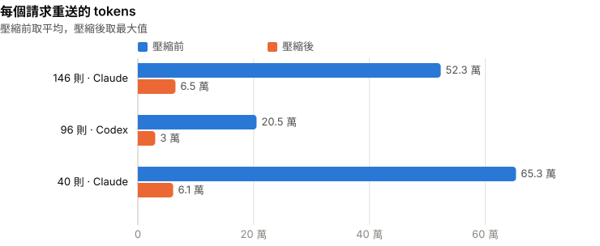

# 壓縮實測

[English](benchmarks.md) ｜ 繁體中文 ｜ [简体中文](benchmarks.zh-CN.md)

2026-11-15～16 拿真實的對話實測。壓縮怎麼運作見 [how-it-works.zh-TW.md](how-it-works.zh-TW.md#壓縮)。

## 方法

- 每次都在暫存資料夾的對話副本上做，原本的對話不動。
- 「壓縮前」取自同一個對話實際使用時 CLI 自己的用量記錄（Claude 的 `~/.claude/projects`、Codex 的 `~/.codex/sessions`）。
- 「每個請求重送」是一個請求的大小：輸入、快取寫入和快取讀取加起來。
- 每種情況只量過一兩次。數字會隨對話長度、專案大小與模型改變。

## 三個對話一次壓縮

| 對話 | 壓縮前，每個請求重送 | 壓縮本身 | 壓縮後，每個請求重送 |
|---|---|---|---|
| 146 則，Claude（Opus 5.5） | 平均 52.3 萬、最大 96.6 萬（session 一直沒重開時） | 157 秒，分 3 批，共 3 個請求、33.6 萬 tokens | 5.8 萬～6.5 萬 |
| 96 則，主要是 Codex | 平均 20.5 萬、最大 38.9 萬 | 89 秒，分 6 批，共 6 個請求、30.3 萬 | 2.5 萬～3.0 萬 |
| 40 則，Claude（Opus 5.5） | 65.3 萬 | 53 秒，3 個請求、18.7 萬（舊做法） | 5.7 萬～6.1 萬 |

這三組是「邊聊邊記索引」加入之前量的，索引全部由 Agent 在壓縮時一次寫完。

- **直接交原文**：舊做法讓 Agent 自己讀逐字稿。146 則的對話 Claude 分 18 次讀，每讀一段就把前面的內容重送一遍，共 270 萬 tokens；改成把段落原文放進 prompt 後是 33.6 萬，少 88%。Codex 舊做法 26.6 萬，但它沒有讀完整份逐字稿；現在的做法多花約一成，索引從 24 筆變 36 筆。40 則那組用的是舊做法。
- **壓縮後問細節**：每個對話各問兩到三題早期討論的細節，共 11 題，全部答對。Agent 照編號去逐字稿搜尋，一輪 3 萬到 23 萬 tokens。
- **多久省回來**：146 則那組照壓縮前每個請求 50 萬上下算，壓縮本身一個請求就省回來；如果平常會自己重開 session、每個請求 15 萬上下，大約 4 個請求省回來。
- **很大的 session**：在 30.7 萬、只看過一部分內容的 session 裡寫索引，跑了 22 個請求、550 萬 tokens。現在只有 session 看過全部要寫的段落、而且接續比較便宜時，才在原本的 session 裡寫。

## 邊聊邊記索引

真的 Agent 各開一個新對話問 5 題：

| Agent | 有寫索引行 | 照抄上一輪主題 | 壓縮 |
|---|---|---|---|
| Codex | 5／5 | 第 2、4 輪 | 3 筆，19 毫秒，沒有請 Agent |
| Claude | 5／5 | 第 2 輪 | 4 筆，14 毫秒，沒有請 Agent |

Claude 第 4 輪被工作資料夾自己的 Stop hook 帶去做別的事，這是測試環境造成的，跟這個功能無關。

## 長對話接著聊

兩段已經壓縮過的真實對話，複製後各接著問 6 題：

| | Claude，150 則 | Codex，108 則 |
|---|---|---|
| 有寫索引行 | 6／6 | 6／6 |
| 早期細節題 | 5／5 答對 | 4／4 答對 |
| 之後每個請求的 session | 7.2 萬～8.3 萬 | 2.4 萬～5.9 萬 |
| 再壓縮 | Agent 補寫較早的 14 則：1 個請求、31 秒 | Agent 補寫較早的 20 則：1 個請求、16 秒 |

新問的幾輪直接整理，只有加入邊聊邊記之前的段落要請 Agent 補寫。

## 要先講清楚的

- token 數不等於費用。長 session 的請求大多是快取讀取，單價比較低，所以省下的錢比例會比 token 小。146 則那次 token 少 88%，照 API 牌價粗估費用約少四分之一。
- session 越大，壓縮省得越多；session 本來就小的對話不用壓。
- 每輪多寫一行索引多花多少 token，還沒有單獨量過。
- Cursor 和自訂 Agent 沒有量過。
