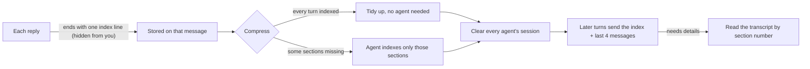

# How AgentDesk works

English ｜ [繁體中文](how-it-works.zh-TW.md) ｜ [简体中文](how-it-works.zh-CN.md)

This page covers the details the [README](../README.md) leaves out: how each feature behaves, where data is stored, and how to work on the code.

## Chat mode and work mode

Every chat has its own mode. Switch the open chat with the mode button at the bottom left of the input box (💬 Chat / 🛠 Work) (not while a turn is running). New chats start in chat mode.

In chat mode AgentDesk tells every agent not to change files and uses each CLI's own read-only option:

| Agent | Chat mode | Work mode default |
|---|---|---|
| Claude Code | `--permission-mode default`, editing tools turned off (`--disallowedTools`) | accept edits automatically |
| Codex CLI | read-only sandbox | may write in the working folder |
| Cursor Agent CLI | `--mode ask` | run commands automatically (`--force`) |
| Custom agents | instruction in the prompt only | as configured |

This is not a sandbox. Claude's editing tools (Edit, Write, MultiEdit, NotebookEdit) stay off even if you allowed them in `permissions.allow`, but Bash commands and MCP tools you allowed still run, and they can change files. A custom agent can ignore the instruction. In a 2026-11-17 test on Windows, Codex's read-only sandbox blocked both a shell write and a write through an MCP tool (`node_repl`).

When an agent needs to change a file in chat mode, it explains what it would change and **Switch to work mode and continue** appears under the reply. Clicking it switches the chat and lets the same agent carry on.

**Approving actions as they happen (Claude only).** In work mode, when Claude's permission is **Manual** (the default for new installs) or **Accept edits**, an action that needs permission (a command, or also an edit under Manual) shows a card in the reply with **Allow** and **Deny**, and Claude waits for your answer. Pressing Stop or deleting the chat counts as Deny. This uses Claude Code's `--permission-prompt-tool` through AgentDesk's MCP bridge; Codex and Cursor have no equivalent in their non-interactive modes, so they keep their own permission settings.

The permission can also be set for one chat: each agent card in the right panel has a permission button under the model (🔒, or ⚠ for Skip permission checks and full access). In work mode it opens a menu for this chat only; **Follow settings** goes back to the setting. In chat mode the cards have no permission button; the top of the right panel says once that all agents are read-only.

A Cursor session that has run read-only cannot go back to writing, so when a chat switches to work mode AgentDesk starts a new Cursor session and passes the earlier chat along as context. Chats created before modes existed open in chat mode.

If another chat in the same folder is running in work mode, AgentDesk asks before sending, since two agents changing files at the same time can overwrite each other. Chat mode and compression only read, so they do not count.

## New chats and working folders

**New chat** or Ctrl+N reuses a new chat you have not sent anything in yet instead of creating another one. New chats with no messages are not listed in the sidebar.

Pick the working folder from the folder menu above the input box before the first message. After that it stays fixed: the top bar shows only the folder name, and clicking it opens the folder in File Explorer. Rename, fresh sessions for all agents, archive and delete are in the ⋯ menu in the top bar, and in the sidebar's right-click menu.

## Shared context

Each chat remembers every agent's session. When you talk to an agent, whatever it has not seen from the other agents is sent with your message. That text counts toward the agent's usage, so it is capped by **Context to include** in Settings: Lean (about 6,000 characters), Standard (16,000, the default) or Full (40,000). Past the cap, the newest messages and the first request of the chat are kept. Each reply shows how many characters were sent with it.

Chats with a progress file use the Lean cap and send only the last 6 messages; the agent reads the background from the progress file.

## Quick replies

When a reply ends by asking you to decide something, the agent is asked to add a hidden line with 2 to 4 short answers. They show as buttons under the latest reply; clicking one sends it to the same agent. The first one also appears as the hint in the input box, and **Tab** fills it in. The request goes to the agent you talk to directly (in Claude's system prompt, at the start of the prompt for the others), not to delegated agents. Agents can skip it, and then no buttons appear.

## Delegation

Claude delegates through built-in MCP tools (`mcp__agents__ask_<agent>`). Delegated agents run in the same working folder and follow the chat's mode, so in chat mode the same read-only limits apply to them.

AgentDesk asks the delegated agent to end its reply with three lines: what it did, which files it changed, and what is unfinished. Replies handed back to Claude are trimmed to the context cap; when a reply is longer, the full text is saved as `delegate-<n>.md` in the chat's transcript folder and Claude gets the path.

## Compression



**Transcript.** After every turn AgentDesk writes the chat to `transcript.md`, one numbered section per message. This uses no AI.

**Index as you chat.** Every turn asks the replying agent to end with one line: `[[agentdesk:index]] topic｜outcome｜related files`, passing the previous topic so follow-up questions reuse it. AgentDesk stores the line on the message and removes it from the screen, the saved chat and the transcript. Consecutive turns with the same topic merge into one entry, and their different outcomes are joined. A brief reply (a few sentences, no tools, no delegation) may skip the line.

**Compressing.** Click 🗜 in the top bar, or **Compress** on an agent card in the right panel.

1. Turns that recorded an index line are used as they are.
2. Sections without one, if they contain a reply longer than 300 characters or used tools or delegation, are indexed by the agent you chose; shorter ones get a placeholder entry. If that agent's session has seen every such section and resuming it costs less than a fresh read, the index is written in that session. Otherwise AgentDesk starts a clean session and puts the text of those sections in the prompt, in parts of up to 100,000 characters, one request per part.
3. AgentDesk checks the result: related files that appear neither in those sections nor in the working folder are removed, files changed in those sections are added from the action log, and missing sections get a placeholder entry.
4. Chats without a progress file also get a "Current state" and a "Next steps" line from the agent that writes the missing sections. When no agent is needed, the lines from an earlier compression stay, marked with the section they were written at.
5. The entries are appended to `index.md`, and every agent's session is cleared.

From then on, an agent starting a session gets the index plus the recent messages (the last 4 the index covers and anything after), and reads the transcript by section number when it needs details. When the same matter has several entries with different outcomes, the agent is told the latest one wins, and that the progress file and recent messages beat the index. A line in the chat marks how far the index reaches; click it to open `index.md`. Compressing again only covers the new sections.

Measured results are in [benchmarks.md](benchmarks.md).

## Progress files

When you switch to work mode you can name the work. AgentDesk creates `docs/進程/<work name>.md` in the working folder: task list, progress, decisions and verification. AgentDesk tells the agent to list the tasks first, wait for your approval, and update the file on turns that make progress. **Resume work** above the input box picks up an existing progress file in a new chat, and **Work status** in the right panel shows the resume notes and tasks.

When one more task is marked done and the largest session in the chat is 50,000 tokens or more, a line above the input box suggests **Restart sessions**. The state lives in the progress file, so restarting loses nothing. For a small fix, choose **No progress file**.

## Agent activity panel

The right panel shows the current chat only: whether each agent is idle or working, what it is doing, and work finished recently.

- **Remaining usage** (5-hour and weekly): Claude updates after every reply, Codex is read every 5 minutes, Cursor does not report it.
- **Session size**: the tokens re-sent on every later turn at minimum. Exact for Claude, estimated for Codex and Cursor. Above 100,000 it is flagged and **Compress** appears on the card.
- **Restart** clears that agent's session in this chat.
- Below 1,100 px of window width the right panel hides itself and comes back when the window is wider; ▤ in the top bar shows it anyway.
- **Usage**: each reply shows that turn's tokens (input including cache, plus output) next to the agent name, with the cost when the CLI reports one (Claude, at API prices). The panel shows the total for this chat. Codex and Antigravity report running totals per session, so AgentDesk subtracts the previous turn; the first turn after an AgentDesk update in an existing session shows nothing.

## Claude API fallback

Add an API key under **Claude API (fallback)** in Settings, and when your subscription's weekly limit runs out, Claude continues on the API. Settings can also switch on the 5-hour limit, or turn automatic switching off.

- **How**: while you are logged in with a subscription, the Claude CLI keeps using that login even when given a key (tested 2026-11-18 with Claude Code 2.1.310 and a fake key). So in API mode Claude runs with a separate config folder, `%APPDATA%\AgentDesk\claude-api\` (`CLAUDE_CONFIG_DIR`), which holds no login and can only use the key. The subfolders of `~/.claude` (sessions, skills, plugins) are junctions back to the originals and `CLAUDE.md` and `settings.json` are copied, so sessions carry over when you switch. Connectors and built-in skills that come with a claude.ai account are not available in API mode.
- **When**:
  - If a turn fails because the limit ran out, the same message runs again on the API. Blocked at the start, the whole prompt is resent; blocked partway, Claude is asked to finish the work.
  - If the right panel already shows the weekly limit as used up, the next turn starts on the API.
  - Detection uses the Claude CLI's `rate_limit_event` (status rejected), or the error message when that event is missing. Both follow the CLI's event format; neither has been tested by actually running out of a subscription limit.
- **Notice**: the reply gets a one-line note, and the Claude card in the right panel shows **Using the Claude API**, why it switched, the estimated API balance and when the subscription limit resets.
- **Switching back**: never automatic. Click **Back to subscription** on the card; it turns green once the reset time has passed. With a key set, the card also offers **Use API** to switch by hand.
- **Balance**: Anthropic offers no public API for the remaining credit, so enter the balance from the Billing page of the Claude Console in Settings. AgentDesk then subtracts the cost the Claude CLI reports, so the number is an estimate.
- **Key**: encrypted with Electron's safeStorage (DPAPI on Windows) and stored in `settings.json`. The window only ever gets the last 4 characters, and if encryption is unavailable the key is not saved. Claude gets the key through `apiKeyHelper`: a small node script that asks AgentDesk's local service, which only answers while an API-mode Claude run is active. The key is not in the environment, so commands Claude runs do not see it in `env` or `set`. This stops accidental leaks, not a program that sets out to find the key: anything running under the same Windows account can decrypt DPAPI or ask the way the script does. Only if node cannot be found does AgentDesk fall back to the `ANTHROPIC_API_KEY` environment variable.
- Compression runs Claude on whichever billing is active, but never switches by itself. Delegated agents are not affected.

## Custom agents

**Add another CLI agent** at the bottom of Settings has templates for Antigravity CLI (`agy`), Claude-compatible stream-json and any plain-text CLI. You can set the command, arguments, how the prompt is passed, output format, model, resume flag and a description for Claude.

To add Antigravity CLI: pick **Antigravity CLI (agy)** → **+ Add agent** → **Install**, then **Sign in** (an interactive `agy` opens; finish its sign-in wizard and close it), then save.

If a custom agent's CLI can list its models, put that subcommand in **List-models args** under the advanced section (the Antigravity template uses `models`; the output needs one model per line). Settings can then load the list, and the right panel can switch the model for one chat. The right panel also needs a model flag. With an effort flag and **Effort options**, the effort can be switched the same way.

The Antigravity template leaves the model to the CLI by default (no `--model`) and sets effort to `high`; the models you can pick are whatever `agy models` prints. Antigravity agents saved by older versions get the list-models and effort settings when AgentDesk starts; a model they already chose is kept.

- The model pickers in Settings and the right panel always offer **Let the CLI decide**.
- A model set in Settings or for a chat that is not on the list read is marked **not confirmed available**.
- **Reload** runs `agy models` again every time instead of reusing an earlier list.
- When a run fails, AgentDesk reads the list again. If the chosen model is not on it, the error gets an explanation and a **Choose a model for Antigravity** button. AgentDesk never switches to another model by itself.

## File preview

Clicking a local file in a reply, an attachment, the progress file or the index opens it according to its type:

- Markdown (`.md`, `.markdown`): rendered on the right in the same style as replies. Relative images and links are resolved from the file's own folder; a link to another Markdown or HTML file opens in the same pane.
- HTML (`.html`, `.htm`): loaded in a sandboxed frame on the right. Its scripts run, but cannot reach AgentDesk.
- Images: full-screen viewer. Other files: the default app.

The preview takes the place of the agent panel while it is open, checks the file every 1.5 seconds and redraws when it changes. Drag its left edge to resize it; the width is remembered.

## Where data lives

`%APPDATA%\AgentDesk\`:

- `settings.json`
- `conversations\*.json`
- `attachments\`
- `limits.json`: last known usage
- `transcripts\<chat id>\`: `transcript.md`, `index.md` after compressing, and saved delegation replies

Progress files live under `docs/進程/` in each working folder. AgentDesk runs no server of its own; each CLI sends your prompts to its own provider.

## Development

| Path | What it does |
|---|---|
| `src/main.js` | main process, chat storage, local HTTP endpoint for delegation |
| `src/agents.js` | command lines and stream parsing for each CLI |
| `src/context.js` | earlier chat sent to each agent, and the caps |
| `src/mode.js` | chat / work mode and the instructions given to agents |
| `src/work.js` | work names, progress-file template and parser |
| `src/transcript.js` | writes a chat as a numbered transcript |
| `src/compress.js` | index lines, compression prompts, index checks |
| `src/cli.js` | finds the real executable behind each CLI (avoids `.cmd` shims) |
| `src/connect.js` | CLI detection, install and sign-in for Settings |
| `src/proc.js`, `src/spawner.js` | spawn child processes on a worker thread |
| `src/mcp-bridge.js` | stdio MCP server Claude uses to delegate |
| `src/shared/i18n.js` | UI translations |
| `src/renderer/` | the UI |

Validation:

```bash
node tools/validate.js          # static checks, unit tests, fake-agent integration (~3 s, no AI usage)
node tools/validate.js --e2e    # plus an Electron UI run with fake agents
node tools/validate.js --live   # plus real Claude / Codex / Cursor round trips (uses your quota)
```

The fake agents live in `tools/validate/fixtures/`.

Releasing:

```bash
node tools/release.js 0.2.1 docs/release-v0.2.1.md --dry   # checks and validation only
node tools/release.js 0.2.1 docs/release-v0.2.1.md         # bump, commit, tag, push, GitHub Release
```

The notes file has English, Traditional Chinese and Simplified Chinese parts separated by `---`, each with install steps. The script stops at the first failed step and prints what is already done.
