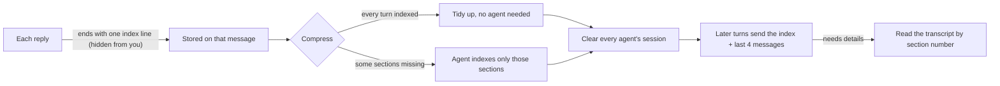

# How AgentDesk works

English ｜ [繁體中文](how-it-works.zh-TW.md) ｜ [简体中文](how-it-works.zh-CN.md)

This page covers the details the [README](../README.md) leaves out: how each feature behaves, where data is stored, and how to work on the code.

## Chat mode and work mode

Every chat has its own mode. Switch the open chat with 💬 / 🛠 at the top right of the left sidebar (not while a turn is running). New chats start in chat mode.

In chat mode AgentDesk tells every agent not to change files and uses each CLI's own read-only option:

| Agent | Chat mode | Work mode default |
|---|---|---|
| Claude Code | `--permission-mode default`, editing tools turned off (`--disallowedTools`) | accept edits automatically |
| Codex CLI | read-only sandbox | may write in the working folder |
| Cursor Agent CLI | `--mode ask` | run commands automatically (`--force`) |
| Custom agents | instruction in the prompt only | as configured |

This is not a sandbox. Claude's editing tools (Edit, Write, MultiEdit, NotebookEdit) stay off even if you allowed them in `permissions.allow`, but Bash commands and MCP tools you allowed still run, and they can change files. A custom agent can ignore the instruction.

When an agent needs to change a file in chat mode, it explains what it would change and **Switch to work mode and continue** appears under the reply. Clicking it switches the chat and lets the same agent carry on.

A Cursor session that has run read-only cannot go back to writing, so when a chat switches to work mode AgentDesk starts a new Cursor session and passes the earlier chat along as context. Chats created before modes existed open in chat mode.

## Shared context

Each chat remembers every agent's session. When you talk to an agent, whatever it has not seen from the other agents is sent with your message. That text counts toward the agent's usage, so it is capped by **Context to include** in Settings: Lean (about 6,000 characters), Standard (16,000, the default) or Full (40,000). Past the cap, the newest messages and the first request of the chat are kept. Each reply shows how many characters were sent with it.

Chats with a progress file use the Lean cap and send only the last 6 messages; the agent reads the background from the progress file.

## Delegation

Claude delegates through built-in MCP tools (`mcp__agents__ask_<agent>`). Delegated agents run in the same working folder and follow the chat's mode, so in chat mode the same read-only limits apply to them.

AgentDesk asks the delegated agent to end its reply with three lines: what it did, which files it changed, and what is unfinished. Replies handed back to Claude are trimmed to the context cap; when a reply is longer, the full text is saved as `delegate-<n>.md` in the chat's transcript folder and Claude gets the path.

## Compression



**Transcript.** After every turn AgentDesk writes the chat to `transcript.md`, one numbered section per message. This uses no AI.

**Index as you chat.** Every turn asks the replying agent to end with one line: `[[agentdesk:index]] topic｜outcome｜related files`, passing the previous topic so follow-up questions reuse it. AgentDesk stores the line on the message and removes it from the screen, the saved chat and the transcript. Consecutive turns with the same topic merge into one entry, and their different outcomes are joined.

**Compressing.** Click 🗜 in the top bar, or **Compress** on an agent card in the right panel.

1. Turns that recorded an index line are used as they are.
2. Sections without one, if they contain a reply, are indexed by the agent you chose. If that agent's session has seen every such section and resuming it costs less than a fresh read, the index is written in that session. Otherwise AgentDesk starts a clean session and puts the text of those sections in the prompt, in parts of up to 100,000 characters, one request per part.
3. AgentDesk checks the result: related files that appear neither in those sections nor in the working folder are removed, files changed in those sections are added from the action log, and missing sections get a placeholder entry.
4. Chats without a progress file also keep a "Current state" and a "Next steps" line.
5. The entries are appended to `index.md`, and every agent's session is cleared.

From then on, an agent starting a session gets the index plus the recent messages (the last 4 the index covers and anything after), and reads the transcript by section number when it needs details. A line in the chat marks how far the index reaches; click it to open `index.md`. Compressing again only covers the new sections.

Measured results are in [benchmarks.md](benchmarks.md).

## Progress files

When you switch to work mode you can name the work. AgentDesk creates `docs/進程/<work name>.md` in the working folder: task list, progress, decisions and verification. AgentDesk tells the agent to list the tasks first, wait for your approval, and update the file on turns that make progress. **Resume work** above the input box picks up an existing progress file in a new chat, and **Work status** in the right panel shows the resume notes and tasks.

When one more task is marked done and the largest session in the chat is 50,000 tokens or more, a line above the input box suggests **Restart sessions**. The state lives in the progress file, so restarting loses nothing. For a small fix, choose **No progress file**.

## Agent activity panel

The right panel shows the current chat only: whether each agent is idle or working, what it is doing, and work finished recently.

- **Remaining usage** (5-hour and weekly): Claude updates after every reply, Codex is read every 5 minutes, Cursor does not report it.
- **Session size**: the tokens re-sent on every later turn at minimum. Exact for Claude, estimated for Codex and Cursor. Above 100,000 it is flagged and **Compress** appears on the card.
- **Restart** clears that agent's session in this chat.

## Custom agents

**Add another CLI agent** at the bottom of Settings has templates for Antigravity CLI (`agy`), Claude-compatible stream-json and any plain-text CLI. You can set the command, arguments, how the prompt is passed, output format, model, resume flag and a description for Claude.

To add Antigravity CLI: pick **Antigravity CLI (agy)** → **+ Add agent** → **Install**, then **Sign in** (an interactive `agy` opens; finish its sign-in wizard and close it), then save.

If a custom agent's CLI can list its models, put that subcommand in **List-models args** under the advanced section (the Antigravity template uses `models`; the output needs one model per line). Settings can then load the list, and the right panel can switch the model for one chat. The right panel also needs a model flag. With an effort flag and **Effort options**, the effort can be switched the same way.

The Antigravity template leaves the model to the CLI by default (no `--model`) and sets effort to `high`; the models you can pick are whatever `agy models` prints. Antigravity agents saved by older versions get the list-models and effort settings when AgentDesk starts; a model they already chose is kept.

- The model pickers in Settings and the right panel always offer **Let the CLI decide**.
- A model set in Settings or for a chat that is not on the list read is marked **not confirmed available**.
- **Reload** runs `agy models` again every time instead of reusing an earlier list.
- When a run fails, AgentDesk reads the list again. If the chosen model is not on it, the error gets an explanation and a **Choose a model for Antigravity** button. AgentDesk never switches to another model by itself.

## Where data lives

`%APPDATA%\AgentDesk\`:

- `settings.json`
- `conversations\*.json`
- `attachments\`
- `limits.json`: last known usage
- `transcripts\<chat id>\`: `transcript.md`, `index.md` after compressing, and saved delegation replies

Progress files live under `docs/進程/` in each working folder. AgentDesk runs no server of its own; each CLI sends your prompts to its own provider.

## Development

| Path | What it does |
|---|---|
| `src/main.js` | main process, chat storage, local HTTP endpoint for delegation |
| `src/agents.js` | command lines and stream parsing for each CLI |
| `src/context.js` | earlier chat sent to each agent, and the caps |
| `src/mode.js` | chat / work mode and the instructions given to agents |
| `src/work.js` | work names, progress-file template and parser |
| `src/transcript.js` | writes a chat as a numbered transcript |
| `src/compress.js` | index lines, compression prompts, index checks |
| `src/cli.js` | finds the real executable behind each CLI (avoids `.cmd` shims) |
| `src/connect.js` | CLI detection, install and sign-in for Settings |
| `src/proc.js`, `src/spawner.js` | spawn child processes on a worker thread |
| `src/mcp-bridge.js` | stdio MCP server Claude uses to delegate |
| `src/shared/i18n.js` | UI translations |
| `src/renderer/` | the UI |

Validation:

```bash
node tools/validate.js          # static checks, unit tests, fake-agent integration (~3 s, no AI usage)
node tools/validate.js --e2e    # plus an Electron UI run with fake agents
node tools/validate.js --live   # plus real Claude / Codex / Cursor round trips (uses your quota)
```

The fake agents live in `tools/validate/fixtures/`.
