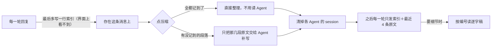

# AgentDesk 的运作方式

[English](how-it-works.md) ｜ [繁體中文](how-it-works.zh-TW.md) ｜ 简体中文

这一页补上 [README](../README.zh-CN.md) 没写的细节：各功能怎么运作、数据存在哪、怎么开发。

## 对话模式与工作模式

每个对话各自记一种模式，用左侧栏右上角的 💬／🛠 切换当前打开的对话，回合运行中不能换。新对话默认是对话模式。

对话模式下，AgentDesk 会交代每个 Agent 不要改文件，并使用各 CLI 自己的只读设置：

| Agent | 对话模式 | 工作模式默认 |
|---|---|---|
| Claude Code | `--permission-mode default`，并停用改文件的工具（`--disallowedTools`） | 自动接受文件修改 |
| Codex CLI | 只读 sandbox | 可写工作文件夹 |
| Cursor Agent CLI | `--mode ask` | 自动运行命令（`--force`） |
| 自定义 Agent | 只在 prompt 里交代 | 按设置 |

这不是沙盒。Claude 改文件的工具（Edit、Write、MultiEdit、NotebookEdit）就算你在 `permissions.allow` 允许过也会停用；但你允许过的 Bash 命令和 MCP 工具照样能用，它们也可能改到文件。自定义 Agent 也可能不照做。2026-11-17 在 Windows 实测，Codex 的只读 sandbox 挡下了用 shell 写文件，也挡下了通过 MCP 工具（`node_repl`）写文件。

对话模式下 Agent 需要改文件时，会先说明要改什么，消息下方出现“切换到工作模式并继续”。点了就切换模式，由同一个 Agent 接着做。

Cursor 的 session 用只读跑过就回不到可写，所以对话切到工作模式时，AgentDesk 会替 Cursor 重开 session，先前的对话作为上下文带过去。加入模式之前的旧对话，打开时是对话模式。

同一个文件夹有别的对话正在用工作模式运行时，发送前会先问，因为两个 Agent 同时改文件可能互相覆盖。对话模式和压缩只读，不算。

## 上下文续接

每个对话记住各 Agent 的 session。你跟某个 Agent 讲话时，它没看过的其他 Agent 往来会跟着发过去。这些内容计入该 Agent 的用量，所以有上限，在设置的“附带上下文”选：精简（约 6,000 字）、标准（16,000 字，默认）、完整（40,000 字）。超过上限时保留最新的往来和对话开头的需求。每条回复上会标出这一轮附了多少字。

有进度文件的对话改用精简上限、只附最近 6 条，背景让 Agent 读进度文件。

## 委派

Claude 通过内置的 MCP 工具（`mcp__agents__ask_<agent>`）委派。被委派的 Agent 在同一个工作文件夹运行，模式跟着对话走，对话模式下一样受只读限制。

AgentDesk 会请被委派的 Agent 在回复最后用三行收尾：做了什么、改了哪些文件、没做完或要注意的。交回 Claude 的回复按附带上下文的上限截短；超过时，完整内容存成这个对话逐字稿文件夹里的 `delegate-<序号>.md`，Claude 拿到这个文件的路径。

## 压缩



**逐字稿**：每一轮结束后，AgentDesk 把对话写成 `transcript.md`，每条消息一段、有编号，不消耗额度。

**边聊边记索引**：每一轮都请回复的 Agent 在最后多写一行 `[[agentdesk:index]] 主题｜结论｜相关文件`，并附上上一轮的主题，同一件事照抄。AgentDesk 把这一行存在消息上，界面、存档和逐字稿都不留。连续几轮主题相同的合成一条，不同的结论接在一起。简短的回复（只有几句、没有用工具或委派）可以不写这一行。

**压缩**：点顶栏的 🗜，或右栏 Agent 卡片上的“压缩”。

1. 有记索引的段落直接用。
2. 没记到的段落，回复超过 300 字或用了工具、委派的，请你选的 Agent 补写；更短的补一条占位。这个 Agent 原来的 session 看过全部要写的段落、而且接续比重新读便宜时，就在原来的 session 里写；否则开干净的 session，AgentDesk 把那几段原文直接放进 prompt，超过 10 万字就分批，每批一个请求。
3. AgentDesk 核对结果：那几段没出现过、工作文件夹里也没有的相关文件去掉，那几段改过的文件从操作记录补上，漏掉的段落补一条占位。
4. 没有进度文件的对话，补写段落的 Agent 另外记“现状”“下一步”两行。不用请 Agent 时，沿用上次压缩记的那两行，并注明是到第几段的状态。
5. 索引追加到 `index.md`，清掉各 Agent 的 session。

之后 Agent 开新 session 时，拿到的是索引加最近的原文（索引涵盖的最后 4 条和之后的全部），要细节就按编号去读逐字稿。同一件事有好几条、结论前后不同时，会告诉 Agent 以最后一条为准；索引跟进度文件或最近的原文不一致时，以后两者为准。消息之间有一条线标出索引涵盖到哪，点击打开 `index.md`。再压一次只处理新的段落。

实测数据在 [benchmarks.zh-CN.md](benchmarks.zh-CN.md)。

## 进度文件

切换到工作模式时可以取一个工作名，AgentDesk 会在工作文件夹创建 `docs/進程/<工作名>.md`，记任务清单、进度、决策与验证。AgentDesk 会交代 Agent：先列任务、等你确认再动手，有进展的那一轮回写进度文件。新对话可以点输入框上方的“接续工作”选现成的进度文件；右栏的“工作现状”显示续传指引与任务清单。

任务清单多完成一项、而且这个对话最大的 session 到 50,000 tokens 以上时，输入框上方会提示“重开 session”。状态都在进度文件里，重开不会丢掉进度。只是改个小地方，选“不建进度文件”。

## 右栏 Agent 工作状况

右栏只看当前这个对话：每个 Agent 是空闲还是工作中、正在做什么，以及最近完成的工作。

- **剩余额度**（5 小时、每周）：Claude 每次回复后更新，Codex 每 5 分钟读一次，Cursor 没有提供。
- **session 大小**：之后每一轮至少要重发的 tokens。Claude 是准的，Codex、Cursor 是估的。超过 100,000 会提醒，卡片上多一个“压缩”按钮。
- **重开**：清掉这个 Agent 在这个对话的 session。

## 自定义 Agent

设置最下方的“添加其他 CLI Agent”有三种模板：Antigravity CLI（`agy`）、Claude 兼容 stream-json、通用 CLI（纯文本）。可以设置命令、参数、prompt 传入方式、输出格式、模型、续接 session 标志，以及给 Claude 的说明。

添加 Antigravity CLI：选“Antigravity CLI（agy）”→“＋ 添加 Agent”→“安装”，再点“登录”（会开一个交互模式的 `agy`，完成登录向导后关掉），最后保存。

自定义 Agent 的 CLI 如果能列出模型，就在高级设置的“列模型参数”填那个子命令（Antigravity 模板默认 `models`，输出要一行一个模型）。填了之后设置页能读取列表，右栏也能为单个对话切换模型；右栏切换还需要填模型标志。填了强度标志与“强度选项”，强度也能同样切换。

Antigravity 模板的模型默认“由 CLI 自己决定”（不带 `--model`），强度默认 `high`，可选的模型按 `agy models` 的实际输出列出。旧版保存的 Antigravity 设置，AgentDesk 启动时会补上列模型参数与强度设置，原来指定的模型不动。

- 设置页和右栏的模型菜单一定有“由 CLI 自己决定”。
- 设置或对话指定的模型不在读到的列表里时，标成“尚未确认可用”。
- “重新读取”每次都重新运行 `agy models`，不用之前读到的列表。
- 运行失败时，AgentDesk 会重新读一次列表。指定的模型不在列表里，错误下方会多一段说明和“选择 Antigravity 的模型”按钮。AgentDesk 不会自己换成别的模型。

## 文件预览

回复里的本地文件、附件、进度文件和索引，点击后按类型打开：

- Markdown（`.md`、`.markdown`）：在右边按回复的样式显示。相对路径的图片和链接以文件所在的文件夹为准；链接到别的 Markdown 或 HTML 文件，会在同一个窗格打开。
- HTML（`.html`、`.htm`）：在右边用沙箱框架打开。页面里的脚本会运行，但碰不到 AgentDesk。
- 图片：全屏查看。其他文件：用系统默认的程序打开。

预览打开时占用右栏的位置，每 1.5 秒检查一次文件，改了就重新显示。拖动左边缘可以调整宽度，下次会记住。

## 数据位置

`%APPDATA%\AgentDesk\`：

- `settings.json`
- `conversations\*.json`
- `attachments\`
- `limits.json`：最近读到的额度
- `transcripts\<对话 id>\`：`transcript.md`、压缩后的 `index.md`、存下来的委派回复

进度文件在各个工作文件夹的 `docs/進程/` 下。AgentDesk 没有自己的服务器；各 CLI 会把 prompt 发到各自的服务商。

## 开发

| 路径 | 用途 |
|---|---|
| `src/main.js` | 主进程、对话保存、委派用的本机 HTTP |
| `src/agents.js` | 各 CLI 的命令组成与流式解析 |
| `src/context.js` | 附给 Agent 的先前对话与上限 |
| `src/mode.js` | 对话／工作模式与给 Agent 的说明 |
| `src/work.js` | 工作名、进度文件的模板与读取 |
| `src/transcript.js` | 把对话写成有编号的逐字稿 |
| `src/compress.js` | 索引行、压缩的 prompt、索引核对 |
| `src/cli.js` | 找 CLI 实际的可执行文件（避开 `.cmd` shim） |
| `src/connect.js` | 设置页的 CLI 检测、安装、登录 |
| `src/proc.js`、`src/spawner.js` | 在 worker thread 创建子进程 |
| `src/mcp-bridge.js` | 给 Claude 委派用的 stdio MCP server |
| `src/shared/i18n.js` | 界面语言对照 |
| `src/renderer/` | 界面 |

验证：

```bash
node tools/validate.js          # 静态检查、单元测试、假 Agent 集成（约 3 秒，不消耗额度）
node tools/validate.js --e2e    # 再加 Electron 界面测试（假 Agent）
node tools/validate.js --live   # 再加真的 Claude／Codex／Cursor 两轮续接（会消耗额度）
```

假 Agent 放在 `tools/validate/fixtures/`。

发版：

```bash
node tools/release.js 0.2.1 docs/release-v0.2.1.md --dry   # 只做检查与验证
node tools/release.js 0.2.1 docs/release-v0.2.1.md         # 改版本号、提交、打 tag、推送、创建 GitHub Release
```

说明文件要有英文、繁中、简中三段，用 `---` 分开，每段都有安装说明。任何一步失败就停，并打印已经做到哪里。
