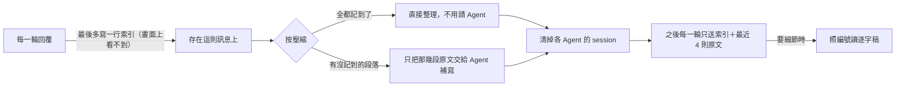

# AgentDesk 的運作方式

[English](how-it-works.md) ｜ 繁體中文 ｜ [简体中文](how-it-works.zh-CN.md)

這一頁補上 [README](../README.zh-TW.md) 沒寫的細節：各功能怎麼運作、資料存在哪、怎麼開發。

## 對話模式與工作模式

每個對話各自記一種模式，用左側欄右上角的 💬／🛠 切換目前開著的對話，回合執行中不能換。新對話預設是對話模式。

對話模式下，AgentDesk 會交代每個 Agent 不要改檔，並使用各 CLI 自己的唯讀設定：

| Agent | 對話模式 | 工作模式預設 |
|---|---|---|
| Claude Code | `--permission-mode default` | 自動接受改檔 |
| Codex CLI | 唯讀 sandbox | 可寫工作資料夾 |
| Cursor Agent CLI | `--mode ask` | 自動執行指令（`--force`） |
| 自訂 Agent | 只在 prompt 裡交代 | 照設定 |

這不是沙盒。你自己在 Claude Code 設定裡允許的規則（`permissions.allow`）照樣放行，自訂 Agent 也可能不照做。

對話模式下 Agent 需要改檔時，會先說明要改什麼，訊息下方出現「切到工作模式並繼續」。按了就切換模式，由同一個 Agent 接著做。

Cursor 的 session 用唯讀跑過就回不到可寫，所以對話切到工作模式時，AgentDesk 會替 Cursor 重開 session，先前的對話當作上下文帶過去。加入模式之前的舊對話，打開時是對話模式。

## 上下文接續

每個對話記住各 Agent 的 session。你跟某個 Agent 講話時，它沒看過的其他 Agent 往來會跟著送過去。這些內容算在該 Agent 的用量裡，所以有上限，在設定的「附帶上下文」選：精簡（約 6,000 字）、標準（16,000 字，預設）、完整（40,000 字）。超過上限時保留最新的往來和對話開頭的需求。每則回覆上會標出這一輪附了多少字。

有進程檔的對話改用精簡上限、只附最近 6 則，背景讓 Agent 讀進程檔。

## 委派

Claude 透過內建的 MCP 工具（`mcp__agents__ask_<agent>`）委派。被委派的 Agent 在同一個工作資料夾執行，模式跟著對話走，對話模式下一樣受唯讀限制。

AgentDesk 會請被委派的 Agent 在回覆最後用三行收尾：做了什麼、改了哪些檔、沒做完或要注意的。交回 Claude 的回覆照附帶上下文的上限截短；超過時，完整內容存成這個對話逐字稿資料夾裡的 `delegate-<序號>.md`，Claude 拿到這個檔的路徑。

## 壓縮



**逐字稿**：每一輪結束後，AgentDesk 把對話寫成 `transcript.md`，每則訊息一段、有編號，不花額度。

**邊聊邊記索引**：每一輪都請回覆的 Agent 在最後多寫一行 `[[agentdesk:index]] 主題｜結論｜相關檔案`，並附上上一輪的主題，同一件事照抄。AgentDesk 把這一行存在訊息上，畫面、存檔和逐字稿都不留。連續幾輪主題相同的合成一筆，不同的結論接在一起。

**壓縮**：按頂列的 🗜，或右欄 Agent 卡片上的「壓縮」。

1. 有記索引的段落直接用。
2. 沒記到、而且裡面有回覆的段落，請你選的 Agent 補寫。這個 Agent 原本的 session 看過全部要寫的段落、而且接續比重新讀便宜時，就在原本的 session 裡寫；否則開乾淨的 session，AgentDesk 把那幾段原文直接放進 prompt，超過 10 萬字就分批，每批一個請求。
3. AgentDesk 核對結果：那幾段沒出現過、工作資料夾裡也沒有的相關檔案拿掉，那幾段改過的檔從動作記錄補上，漏掉的段落補一筆佔位。
4. 沒有進程檔的對話另外記「現況」「下一步」兩行。
5. 索引追加到 `index.md`，清掉各 Agent 的 session。

之後 Agent 開新 session 時，拿到的是索引加最近的原文（索引涵蓋的最後 4 則和之後的全部），要細節就照編號去讀逐字稿。訊息之間有一條線標出索引涵蓋到哪，點了開啟 `index.md`。再壓一次只處理新的段落。

實測數據在 [benchmarks.zh-TW.md](benchmarks.zh-TW.md)。

## 進程檔

切到工作模式時可以取一個工作名，AgentDesk 會在工作資料夾建立 `docs/進程/<工作名>.md`，記任務清單、進度、決策與驗證。AgentDesk 會交代 Agent：先列任務、等你核准再動手，有進展的那一輪回寫進程檔。新對話可以按輸入框上方的「接續工作」選現成的進程檔；右欄的「工作現況」顯示續傳指引與任務清單。

任務清單多完成一項、而且這個對話最大的 session 到 50,000 tokens 以上時，輸入框上方會提示「重開 session」。狀態都在進程檔裡，重開不會丟掉進度。只是改個小地方，選「不建進程檔」。

## 右欄 Agent 工作狀況

右欄只看目前這個對話：每個 Agent 是閒置還是工作中、正在做什麼，以及最近完成的工作。

- **剩餘額度**（5 小時、每週）：Claude 每次回覆後更新，Codex 每 5 分鐘讀一次，Cursor 沒有提供。
- **session 大小**：之後每一輪至少要重送的 tokens。Claude 是準的，Codex、Cursor 是估的。超過 100,000 會提醒，卡片上多一顆「壓縮」。
- **重開**：清掉這個 Agent 在這個對話的 session。

## 自訂 Agent

設定最下方的「新增其他 CLI Agent」有三種範本：Antigravity CLI（`agy`）、Claude 相容 stream-json、一般 CLI（純文字）。可以設定指令、參數、prompt 傳入方式、輸出格式、模型、接續 session 旗標，以及給 Claude 的說明。

加入 Antigravity CLI：選「Antigravity CLI（agy）」→「＋ 新增 Agent」→「安裝」，再按「登入」（會開一個互動模式的 `agy`，完成登入精靈後關掉），最後儲存。

## 資料位置

`%APPDATA%\AgentDesk\`：

- `settings.json`
- `conversations\*.json`
- `attachments\`
- `limits.json`：最近讀到的額度
- `transcripts\<對話 id>\`：`transcript.md`、壓縮後的 `index.md`、存下來的委派回覆

進程檔在各個工作資料夾的 `docs/進程/` 底下。AgentDesk 沒有自己的伺服器；各 CLI 會把 prompt 送到各自的服務商。

## 開發

| 路徑 | 用途 |
|---|---|
| `src/main.js` | 主程序、對話儲存、委派用的本機 HTTP |
| `src/agents.js` | 各 CLI 的指令組成與串流解析 |
| `src/context.js` | 附給 Agent 的先前對話與上限 |
| `src/mode.js` | 對話／工作模式與給 Agent 的說明 |
| `src/work.js` | 工作名、進程檔的範本與讀取 |
| `src/transcript.js` | 把對話寫成有編號的逐字稿 |
| `src/compress.js` | 索引行、壓縮的 prompt、索引核對 |
| `src/cli.js` | 找 CLI 實際的執行檔（避開 `.cmd` shim） |
| `src/connect.js` | 設定頁的 CLI 偵測、安裝、登入 |
| `src/proc.js`、`src/spawner.js` | 在 worker thread 建立子行程 |
| `src/mcp-bridge.js` | 給 Claude 委派用的 stdio MCP server |
| `src/shared/i18n.js` | 介面語言對照 |
| `src/renderer/` | 介面 |

驗證：

```bash
node tools/validate.js          # 靜態檢查、單元測試、假 Agent 整合（約 3 秒，不花額度）
node tools/validate.js --e2e    # 再加 Electron 畫面測試（假 Agent）
node tools/validate.js --live   # 再加真的 Claude／Codex／Cursor 兩輪接續（會用額度）
```

假 Agent 放在 `tools/validate/fixtures/`。
