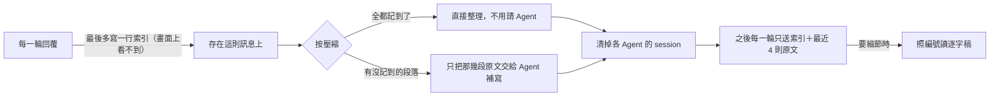

# AgentDesk 的運作方式

[English](how-it-works.md) ｜ 繁體中文 ｜ [简体中文](how-it-works.zh-CN.md)

這一頁補上 [README](../README.zh-TW.md) 沒寫的細節：各功能怎麼運作、資料存在哪、怎麼開發。

## 對話模式與工作模式

每個對話各自記一種模式，用輸入框左下的模式按鈕（💬 對話／🛠 工作）切換目前開著的對話，回合執行中不能換。新對話預設是對話模式。

對話模式下，AgentDesk 會交代每個 Agent 不要改檔，並使用各 CLI 自己的唯讀設定：

| Agent | 對話模式 | 工作模式預設 |
|---|---|---|
| Claude Code | `--permission-mode default`，並停用改檔工具（`--disallowedTools`） | 自動接受改檔 |
| Codex CLI | 唯讀 sandbox | 可寫工作資料夾 |
| Cursor Agent CLI | `--mode ask` | 自動執行指令（`--force`） |
| 自訂 Agent | 只在 prompt 裡交代 | 照設定 |

這不是沙盒。Claude 的改檔工具（Edit、Write、MultiEdit、NotebookEdit）就算你在 `permissions.allow` 允許過也會停用；但你允許過的 Bash 指令和 MCP 工具照樣能用，它們也可能改到檔案。自訂 Agent 也可能不照做。2026-11-17 在 Windows 實測，Codex 的唯讀 sandbox 擋下了用 shell 寫檔，也擋下了透過 MCP 工具（`node_repl`）寫檔。

對話模式下 Agent 需要改檔時，會先說明要改什麼，訊息下方出現「切到工作模式並繼續」。按了就切換模式，由同一個 Agent 接著做。

**執行中逐項核准（只有 Claude）**：工作模式下，Claude 的權限是「手動」（新安裝的預設）或「接受編輯」時，需要許可的動作（指令；手動時連改檔也算）會在回覆裡跳出卡片，有「允許」「拒絕」，Claude 會等你按。按停止或刪掉對話都算拒絕。這用的是 Claude Code 的 `--permission-prompt-tool`，經 AgentDesk 的 MCP bridge 問你；Codex、Cursor 的非互動模式沒有對應的做法，照各自的權限設定。

權限也可以只改這個對話：右欄每張 Agent 卡片在模型下面有一顆權限按鈕（🔒；「略過權限確認」和完全存取顯示 ⚠）。工作模式時點了會打開只套用在這個對話的權限選單，選「跟隨設定」就回到設定頁的值。對話模式時卡片上沒有權限按鈕，右欄上方寫一次「對話模式：所有 Agent 唯讀」。

Cursor 的 session 用唯讀跑過就回不到可寫，所以對話切到工作模式時，AgentDesk 會替 Cursor 重開 session，先前的對話當作上下文帶過去。加入模式之前的舊對話，打開時是對話模式。

同一個資料夾有別的對話正在用工作模式執行時，送出前會先問，因為兩個 Agent 同時改檔可能互相蓋掉。對話模式和壓縮只讀，不算。

## 新對話與工作資料夾

按「新對話」或 Ctrl+N 時，如果已經有還沒送過訊息的新對話，AgentDesk 會沿用它，不另外建。沒送過訊息的新對話不列在側欄。

工作資料夾在送出第一則訊息前，從輸入框上方的資料夾選單選。開始對話後就固定，頂列只顯示資料夾名稱，點了在檔案總管開啟。釘選、重新命名、封存、刪除放在頂列的 ⋯ 選單，側欄的右鍵選單也有。

## 上下文接續

每個對話記住各 Agent 的 session。你跟某個 Agent 講話時，它沒看過的其他 Agent 往來會跟著送過去。這些內容算在該 Agent 的用量裡，所以有上限，在設定的「附帶上下文」選：精簡（約 6,000 字）、標準（16,000 字，預設）、完整（40,000 字）。超過上限時保留最新的往來和對話開頭的需求。每則回覆上會標出這一輪附了多少字。

有進程檔的對話改用精簡上限、只附最近 6 則，背景讓 Agent 讀進程檔。

## 快速回覆

回覆最後如果在等你做決定，AgentDesk 會請 Agent 另外寫一行看不到的選項，列 2～4 個簡短的回答。這些選項會在最後一則回覆下面變成按鈕，按了就直接送給同一個 Agent。第一個選項也會出現在輸入框的提示字，按 **Tab** 就填進去。這個要求只給你直接對話的 Agent（Claude 放在 system prompt，其他放在 prompt 最前面），不給被委派的 Agent。Agent 沒寫的話就不會出現按鈕。

## 委派

Claude 透過內建的 MCP 工具（`mcp__agents__ask_<agent>`）委派。被委派的 Agent 在同一個工作資料夾執行，模式跟著對話走，對話模式下一樣受唯讀限制。

AgentDesk 會請被委派的 Agent 在回覆最後用三行收尾：做了什麼、改了哪些檔、沒做完或要注意的。交回 Claude 的回覆照附帶上下文的上限截短；超過時，完整內容存成這個對話逐字稿資料夾裡的 `delegate-<序號>.md`，Claude 拿到這個檔的路徑。

## 壓縮



**逐字稿**：每一輪結束後，AgentDesk 把對話寫成 `transcript.md`，每則訊息一段、有編號，不花額度。

**邊聊邊記索引**：每一輪都請回覆的 Agent 在最後多寫一行 `[[agentdesk:index]] 主題｜結論｜相關檔案`，並附上上一輪的主題，同一件事照抄。AgentDesk 把這一行存在訊息上，畫面、存檔和逐字稿都不留。連續幾輪主題相同的合成一筆，不同的結論接在一起。簡短的回覆（只有幾句、沒有用工具或委派）可以不寫這一行。

**壓縮**：按頂列的 🗜，或右欄 Agent 卡片上的「壓縮」。

1. 有記索引的段落直接用。
2. 沒記到的段落，回覆超過 300 字或用了工具、委派的，請你選的 Agent 補寫；更短的補一筆佔位。這個 Agent 原本的 session 看過全部要寫的段落、而且接續比重新讀便宜時，就在原本的 session 裡寫；否則開乾淨的 session，AgentDesk 把那幾段原文直接放進 prompt，超過 10 萬字就分批，每批一個請求。
3. AgentDesk 核對結果：那幾段沒出現過、工作資料夾裡也沒有的相關檔案拿掉，那幾段改過的檔從動作記錄補上，漏掉的段落補一筆佔位。
4. 沒有進程檔的對話，補寫段落的 Agent 另外記「現況」「下一步」兩行。不用請 Agent 時，沿用上次壓縮記的那兩行，並註明是到第幾段的狀態。
5. 索引追加到 `index.md`，清掉各 Agent 的 session。

之後 Agent 開新 session 時，拿到的是索引加最近的原文（索引涵蓋的最後 4 則和之後的全部），要細節就照編號去讀逐字稿。同一件事有好幾筆、結論前後不同時，會告訴 Agent 以最後一筆為準；索引跟進程檔或最近的原文不一致時，以後兩者為準。訊息之間有一條線標出索引涵蓋到哪，點了開啟 `index.md`。再壓一次只處理新的段落。

實測數據在 [benchmarks.zh-TW.md](benchmarks.zh-TW.md)。

## 進程檔

切到工作模式時可以取一個工作名，AgentDesk 會在工作資料夾建立 `docs/進程/<工作名>.md`，記任務清單、進度、決策與驗證。AgentDesk 會交代 Agent：先列任務、等你核准再動手，有進展的那一輪回寫進程檔。新對話可以按輸入框上方的「接續工作」選現成的進程檔；右欄的「工作現況」顯示續傳指引與任務清單。

只是改個小地方，選「不建進程檔」。

## 右欄 Agent 工作狀況

右欄只看目前這個對話：每個 Agent 是閒置還是工作中、正在做什麼，以及最近完成的工作。

- **剩餘額度**（5 小時、每週）：Claude 每次回覆後更新，Codex 每 5 分鐘讀一次，Cursor 沒有提供。這個對話的 Claude 用 Fable 時多一條「Fable 每週」：Claude CLI 只在 Fable 的回合回報這一項（`seven_day_overage_included`，2026-11-20 實測），所以要用 Fable 跑過一輪才會出現。
- **session 大小**：之後每一輪至少要重送的 tokens，以及佔模型上下文的幾成（例如「session 511k／1M（51%）」）。Claude 的大小是準的，上下文大小照 Claude 回報的；Codex、Cursor 的大小是估的，上下文以 200k 估（標「~」）。
- **建議壓縮**：任何一個 Agent 用到上下文的八成時，卡片標「接近上限，建議壓縮」、多一顆「壓縮」，輸入框上方也會提示，按「壓縮」就好。再大下去，CLI 會自己摘要或塞不下，前面的細節容易丟掉。按「先不要」之後，那個 Agent 再多用一成才會再提。
- 沒有「重開」按鈕：長對話要省額度用壓縮。AgentDesk 只在需要時自己清掉 session（session 失效、Cursor 從唯讀切到可寫、壓縮完）。
- 視窗寬度不到 1,100 px 時右欄自動收起，拉寬後再打開；收起時按頂列的 ▤ 也能打開。
- **用量**：每則回覆的名字旁邊顯示這一輪的 tokens（輸入含快取，加上輸出），CLI 有回報費用時一起顯示（Claude，API 牌價）。右欄顯示這個對話的加總。Codex 和 Antigravity 回報的是整個 session 的累計，AgentDesk 會減掉上一輪；更新 AgentDesk 後，原本 session 的第一輪不顯示。

## Claude API 備用

在設定的「Claude API（備用）」填 API 金鑰後，訂閱的每週額度用完時，Claude 會改用 API 繼續。設定裡可以改成 5 小時額度用完也切，或關掉自動切換。

- **怎麼切**：已經登入訂閱帳號時，Claude CLI 就算拿到金鑰也照樣用登入的帳號（2026-11-18 用 Claude Code 2.1.310、假金鑰實測）。所以 API 模式的 Claude 改用另一個設定資料夾 `%APPDATA%\AgentDesk\claude-api\`（`CLAUDE_CONFIG_DIR`）：裡面沒有登入憑證，只能用金鑰；`~/.claude` 的子資料夾（session、skills、plugins）用 junction 指回原處，`CLAUDE.md`、`settings.json` 複製過來，所以切換前後的 session 接得上。claude.ai 帳號才有的連接器與內建技能在 API 模式用不到。
- **什麼時候切**：
  - 回合因為額度用完而失敗時，同一則訊息改用 API 重跑一次。一開始就被擋，就整段重送；做到一半才擋，就請 Claude 接著做。
  - 右欄記的每週額度已經用完時，下一輪一開始就改用 API。
  - 判斷依據是 Claude CLI 的 `rate_limit_event`（被擋時 status 是 rejected），沒有這個事件時看錯誤訊息。這兩種訊號是照 CLI 的事件格式寫的，還沒有真的把訂閱額度用完測過。
- **提示**：切換時訊息裡會多一行說明，右欄的 Claude 卡片會顯示「正在用 Claude API」、為什麼切、API 約剩多少、訂閱額度預計什麼時候恢復。
- **切回來**：不會自動切回，按卡片上的「切回訂閱」。到了恢復時間，卡片會變綠色提醒你。訂閱模式下設了金鑰時，卡片上也有「改用 API」可以手動切過去。
- **剩餘額度**：Anthropic 沒有提供查 API 餘額的公開介面，所以要自己到 Claude Console 的 Billing 頁看餘額，填進設定。之後 AgentDesk 用 Claude CLI 回報的費用往下扣，顯示的是估計值。
- **金鑰**：用 Electron 的 safeStorage 加密（Windows 是 DPAPI）存在 `settings.json`，畫面只拿得到末 4 碼，不能加密的電腦不會存。Claude 要金鑰時執行 `apiKeyHelper`：一支用 node 跑的小程式，向 AgentDesk 的本機服務要，只有 API 模式的 Claude 正在跑時才拿得到。金鑰不放進環境變數，Claude 執行的指令跑 `env`、`set` 時看不到。這擋得住不小心外洩，擋不住刻意找金鑰的程式：同一個 Windows 帳號下的程式都能解開 DPAPI，也能照著小程式去要。電腦上找不到 node 時，才退回用環境變數 `ANTHROPIC_API_KEY`。
- 壓縮時 Claude 寫索引也照目前的計費方式跑，但不會自動切換。委派出去的 Agent 不受影響。

## 自訂 Agent

設定最下方的「新增其他 CLI Agent」有三種範本：Antigravity CLI（`agy`）、Claude 相容 stream-json、一般 CLI（純文字）。可以設定指令、參數、prompt 傳入方式、輸出格式、模型、接續 session 旗標，以及給 Claude 的說明。

加入 Antigravity CLI：選「Antigravity CLI（agy）」→「＋ 新增 Agent」→「安裝」，再按「登入」（會開一個互動模式的 `agy`，完成登入精靈後關掉），最後儲存。

自訂 Agent 的 CLI 如果能列出模型，就在進階設定的「列模型參數」填那個子指令（Antigravity 範本預設 `models`，輸出要一行一個模型）。填了之後設定頁能讀取清單，右欄也能替單一對話切換模型；右欄切換還需要填模型旗標。填了強度旗標與「強度選項」，強度也能同樣切換。

Antigravity 範本的模型預設「CLI 自己決定」（不帶 `--model`），強度預設 `high`，可選的模型照 `agy models` 的實際輸出列出。舊版存下的 Antigravity 設定，AgentDesk 啟動時會補上列模型參數與強度設定，原本指定的模型不動。

- 設定頁和右欄的模型選單一定有「CLI 自己決定」。
- 設定或對話指定的模型不在讀到的清單裡時，標成「尚未確認可用」。
- 「重新讀取」每次都重跑 `agy models`，不用之前讀到的清單。
- 執行失敗時，AgentDesk 會重讀一次清單。指定的模型不在清單裡，錯誤下面會多一段說明和「選擇 Antigravity 的模型」按鈕。AgentDesk 不會自己換成別的模型。

## 檔案預覽

回覆裡的本機檔案、附件、進程檔和索引，點了依類型打開：

- Markdown（`.md`、`.markdown`）：在右邊照回覆的樣式畫出來。相對路徑的圖片和連結以檔案所在的資料夾為準；連到別的 Markdown 或 HTML 檔，會在同一個窗格打開。
- HTML（`.html`、`.htm`）：在右邊用沙箱框架打開。頁面裡的腳本會執行，但碰不到 AgentDesk。
- 圖片：全螢幕檢視。其他檔案：用系統預設的程式開。

預覽開著的時候佔掉右欄的位置，每 1.5 秒檢查一次檔案，改了就重畫。拖左緣可以調整寬度，下次會記得。

## 資料位置

`%APPDATA%\AgentDesk\`：

- `settings.json`
- `conversations\*.json`
- `attachments\`
- `limits.json`：最近讀到的額度
- `transcripts\<對話 id>\`：`transcript.md`、壓縮後的 `index.md`、存下來的委派回覆

進程檔在各個工作資料夾的 `docs/進程/` 底下。AgentDesk 沒有自己的伺服器；各 CLI 會把 prompt 送到各自的服務商。

## 開發

| 路徑 | 用途 |
|---|---|
| `src/main.js` | 主程序、對話儲存、委派用的本機 HTTP |
| `src/agents.js` | 各 CLI 的指令組成與串流解析 |
| `src/context.js` | 附給 Agent 的先前對話與上限 |
| `src/mode.js` | 對話／工作模式與給 Agent 的說明 |
| `src/work.js` | 工作名、進程檔的範本與讀取 |
| `src/transcript.js` | 把對話寫成有編號的逐字稿 |
| `src/compress.js` | 索引行、壓縮的 prompt、索引核對 |
| `src/cli.js` | 找 CLI 實際的執行檔（避開 `.cmd` shim） |
| `src/connect.js` | 設定頁的 CLI 偵測、安裝、登入 |
| `src/proc.js`、`src/spawner.js` | 在 worker thread 建立子行程 |
| `src/mcp-bridge.js` | 給 Claude 委派用的 stdio MCP server |
| `src/shared/i18n.js` | 介面語言對照 |
| `src/renderer/` | 介面 |

驗證：

```bash
node tools/validate.js          # 靜態檢查、單元測試、假 Agent 整合（約 3 秒，不花額度）
node tools/validate.js --e2e    # 再加 Electron 畫面測試（假 Agent）
node tools/validate.js --live   # 再加真的 Claude／Codex／Cursor 兩輪接續（會用額度）
```

假 Agent 放在 `tools/validate/fixtures/`。

發版：

```bash
node tools/release.js 0.2.1 docs/release-v0.2.1.md --dry   # 只做檢查與驗證
node tools/release.js 0.2.1 docs/release-v0.2.1.md         # 改版號、提交、打 tag、推送、建立 GitHub Release
```

說明檔要有英文、繁中、簡中三段，用 `---` 分開，每段都有安裝說明。任何一步失敗就停，並印出已經做到哪裡。
